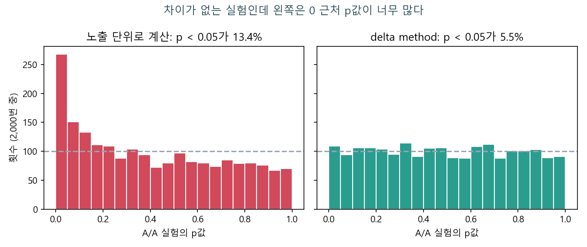
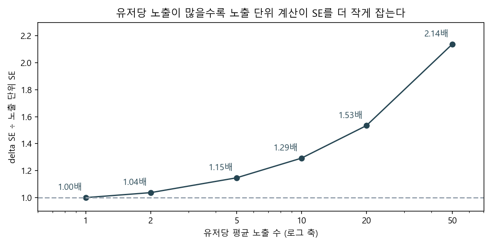
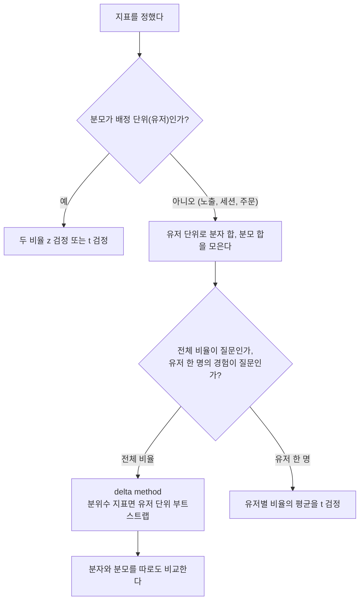

# 건수 기준 지표와 delta method

> **한 줄 요약** 배정은 유저 단위로 했는데 클릭률처럼 분모가 노출, 주문인 지표를 노출 하나하나가 독립인 것처럼 검정하면 분산이 작게 잡혀 거짓 양성이 늘어난다. delta method는 유저 단위로 모은 분자와 분모로 비율의 분산을 근사해서, 배정 단위에 맞는 표준오차를 돌려준다.

## 언제 쓰나

- 클릭률(클릭 ÷ 노출), 세션당 페이지뷰, 객단가(매출 ÷ 주문)처럼 분모가 유저보다 잘게 쪼개진 지표를 A/B로 비교할 때
- "+4% 올랐다"처럼 상대 변화율로 결과를 보고하면서 신뢰구간을 붙여야 할 때
- 리뷰에서 "분석 단위가 배정 단위와 같나"라는 질문을 받았을 때

## 판단 기준

### 1. 배정 단위와 지표 분모 단위를 먼저 맞춰 본다

검정은 서로 독립인 단위를 센다는 전제에서 출발한다. A/B 실험에서 독립인 단위는 무작위로 나눈 단위, 보통 유저다.

| 지표 | 분모 단위 | 배정 단위(유저)와 같나 | 검정 |
|---|---|---|---|
| 유저 전환율 (구매한 유저 ÷ 유저) | 유저 | 같다 | 두 비율 z 검정 |
| 유저당 매출 | 유저 | 같다 | t 검정 |
| 클릭률 (클릭 ÷ 노출) | 노출 | 다르다 | delta method |
| 객단가 (매출 ÷ 주문) | 주문 | 다르다 | delta method |
| 상대 변화율 (실험군 ÷ 대조군 − 1) | 두 그룹 값의 비율 | 비율 자체가 문제 | delta method |

분모 단위가 유저와 같으면 지금까지 쓰던 검정을 그대로 쓰면 된다. 다르면 이 문서의 방법이 필요하다.

### 2. 노출 단위로 세면 왜 틀리나

설문을 100명에게 한 번씩 받은 것과 10명에게 열 번씩 받은 것은 응답 수가 같아도 정보량이 다르다. 같은 사람의 열 번은 비슷한 답을 하기 때문이다. 클릭도 같다. 평소에 잘 누르는 유저는 노출 열 번에서 여러 번 누르고, 잘 안 누르는 유저는 열 번 다 지나친다.

노출 로그를 그대로 두 비율 z 검정에 넣으면, 이 열 번을 서로 다른 열 명처럼 센다. 그래서 표준오차가 실제보다 작아지고 p값이 실제보다 작아진다.

그룹당 5,000명, 유저당 평균 노출 10번, 클릭 성향이 유저마다 다른 가상 데이터로 차이가 전혀 없는 A/A 실험을 2,000번 돌려 봤다.



| 계산 방법 | p < 0.05 비율 (기대값 5%) |
|---|---|
| 노출 단위 두 비율 z 검정 | 13.4% |
| delta method | 5.5% |

효과가 없는데 일곱 번 중 한 번꼴로 "유의하다"가 나온다. p값 분포가 평평해야 하는데 0 근처로 몰려 있으면 분산을 작게 잡고 있다는 신호다.

### 3. 얼마나 작게 잡히나

어긋나는 정도는 유저당 노출이 많을수록, 유저마다 클릭 성향 차이가 클수록 커진다. 클릭 성향 분포는 그대로 두고 유저당 평균 노출만 바꿔 보면 이렇다.

| 유저당 평균 노출 | 실제 SE ÷ 노출 단위 SE |
|---|---|
| 1 | 1.00 |
| 2 | 1.04 |
| 5 | 1.15 |
| 10 | 1.29 |
| 20 | 1.53 |
| 50 | 2.14 |



노출이 한 번뿐이면 노출이 곧 유저라서 차이가 없다. 피드처럼 한 유저가 하루에 수십 번 노출되는 지면이면 SE가 두 배 넘게 차이 나고, 그만큼 z값이 부풀려진다.

### 4. 대안은 여럿이고 질문이 조금씩 다르다

| 방법 | 무엇을 재나 | 어울릴 때 |
|---|---|---|
| delta method | 전체 클릭 ÷ 전체 노출, 분산만 유저 단위로 | 대시보드 지표 정의를 그대로 두고 검정할 때. 계산이 가볍다 |
| 유저별 비율의 평균 | 유저마다 클릭률을 구해 평균. 유저 한 명에 같은 가중치 | "유저 한 명 한 명의 경험"이 질문일 때. 다른 지표라는 걸 알고 쓴다 |
| 유저 단위 부트스트랩 | delta method와 같은 지표 | 분위수처럼 식으로 분산을 쓰기 어려울 때. 느리다 |
| 노출 단위로 배정 | 노출마다 무작위 | 유저 경험이 섞여도 괜찮은 지면일 때. 설계 단계에서 정한다 |

예시 데이터에서 대조군 클릭률은 전체 기준 10.05%, 유저별 평균 기준 10.11%다. 헤비 유저의 비중을 다르게 두니 값이 다르다. 둘 중 무엇이 맞냐가 아니라 어느 쪽이 실험 질문에 맞냐의 문제이고, 결과표에는 어떤 정의인지 적는다.

## 핵심 패턴

### 식: 분자 흔들림, 분모 흔들림, 둘이 같이 움직이는 정도

유저 i의 클릭 합을 xᵢ, 노출 합을 yᵢ라고 하면 클릭률은 R = x̄ ÷ ȳ 이다. 유저 단위 분산과 공분산으로 R의 분산을 이렇게 근사한다.

$$
\mathrm{Var}(\hat{R}) \approx \frac{1}{n\,\bar{y}^2}\left(\mathrm{Var}(x) - 2R\,\mathrm{Cov}(x, y) + R^2\,\mathrm{Var}(y)\right)
$$

- Var(x): 유저마다 클릭 수가 얼마나 다른가
- Var(y): 유저마다 노출 수가 얼마나 다른가
- Cov(x, y): 노출이 많은 유저가 클릭도 많은 정도. 분자와 분모가 같이 움직이면 비율은 덜 흔들리니 분산을 깎는다

n은 유저 수다. 노출 수가 아니다. 여기서 분석 단위가 배정 단위로 돌아온다.

같은 식을 다르게 보면, 유저마다 lᵢ = (xᵢ − R yᵢ) ÷ ȳ 라는 값을 만들어 그 평균의 분산을 구한 것과 같다(선형화). 그래서 유저 한 명당 한 줄인 값으로 바뀌고, 평소 쓰던 t 검정이나 CUPED에 그대로 넣을 수 있다.

### 데이터는 유저 단위로 먼저 접는다

계산에 필요한 건 유저마다 클릭 합과 노출 합 두 숫자다. 노출 로그를 바로 쓰지 않고 유저 단위로 먼저 모은다.

```sql
select user_id
     , variant
     , count(*)            as impressions
     , sum(clicked)        as clicks
  from impression_log
 where exp_id = 'feed_card_v2'
 group by user_id, variant
```

### 같은 데이터, 두 결론

그룹당 5,000명, 실험군 클릭 성향을 조금 높여 만든 가상 실험이다.

| | 노출 | 클릭 | 클릭률 |
|---|---|---|---|
| 대조군 | 50,770 | 5,100 | 10.05% |
| 실험군 | 50,289 | 5,265 | 10.47% |

| 계산 방법 | 차이 SE | z | p값 | 판정 |
|---|---|---|---|---|
| 노출 단위 두 비율 z 검정 | 0.00191 | 2.22 | 0.026 | 유의 |
| delta method | 0.00248 | 1.71 | 0.087 | 유의하지 않음 |

차이는 +0.42%p로 같고 SE만 1.3배 다르다. delta method 기준 95% 신뢰구간은 −0.06%p에서 +0.91%p로 0을 포함한다. 효과가 없다는 뜻은 아니고, 이 표본으로는 아직 0과 구분이 안 된다는 뜻이다.

```python
import numpy as np
from playbook import ratio_ztest, two_proportion_ztest

def simulate_users(rng, n, ctr_a=2.0):
    imp = rng.negative_binomial(2, 2 / 11, size=n) + 1   # 유저당 노출 평균 10
    ctr = rng.beta(ctr_a, 18, size=n)                     # 유저마다 다른 클릭 성향
    return rng.binomial(imp, ctr), imp

rng = np.random.default_rng(27)
c0, i0 = simulate_users(rng, 5_000)
c1, i1 = simulate_users(rng, 5_000, ctr_a=2.1)

two_proportion_ztest(c0.sum(), i0.sum(), c1.sum(), i1.sum(), pooled=False)  # z 2.22, p 0.026
ratio_ztest(c0, i0, c1, i1)  # diff 0.00424, se 0.00248, p 0.087, 구간 (-0.0006, 0.0091)
```

`ratio_ztest`는 유저마다 한 줄인 분자, 분모 배열을 받는다. 분모가 모두 1이면 그냥 유저 평균 비교가 되고, 이때 scipy의 Welch t 검정과 같은 통계량이 나오는지 테스트로 맞춰 봤다. 유저를 단위로 다시 뽑는 부트스트랩과도 SE가 5% 안에서 맞는다.

### 상대 변화율에도 같은 방법을 쓴다

"클릭률 4.2% 상승"이라고 쓰려면 신뢰구간도 상대값으로 내야 한다. 실험군 ÷ 대조군 역시 비율이라 분모(대조군 값)의 흔들림을 같이 반영해야 한다.

$$
\mathrm{Var}\left(\frac{\hat{R}_1}{\hat{R}_0}\right) \approx \frac{\mathrm{Var}(\hat{R}_1)}{R_0^2} + \frac{R_1^2\,\mathrm{Var}(\hat{R}_0)}{R_0^4}
$$

```python
from playbook import ratio_delta_var, relative_lift_ci

r0, v0 = ratio_delta_var(c0, i0)
r1, v1 = ratio_delta_var(c1, i1)
relative_lift_ci(r0, v0, r1, v1)  # +4.2%, 95% 구간 (-0.7%, +9.2%)
```

### 순서



## 안티패턴

1. **노출 로그를 그대로 두 비율 z 검정에 넣는다** 노출 5만 건을 5만 명처럼 세는 셈이다. A/A에서도 13% 넘게 유의하게 나오는 계산이라, 이 방식으로 낸 p값은 실제보다 낙관적이다. 유저 단위로 접는 것부터 한다.
2. **유저별 클릭률 평균으로 바꾸고 같은 지표라고 생각한다** 분산 문제는 풀리지만 헤비 유저와 라이트 유저에게 같은 가중치를 주는 다른 지표가 된다. 대시보드는 전체 비율인데 검정은 유저 평균으로 하면, 대시보드 숫자와 검정 결과가 따로 논다.
3. **표본 크기를 노출 수로 계산한다** 표본 공식의 n은 독립인 단위 수다. 노출 수를 넣으면 필요한 기간이 실제보다 짧게 나오고, 계획한 기간을 다 채워도 검정력이 모자란다. 과거 데이터로 유저 단위 분산을 구해 표본을 잡는다.
4. **비율만 보고 분자와 분모를 따로 안 본다** 실험안이 노출 수 자체를 바꾸면(카드를 덜 보여 주는 안 등) 클릭률이 올라도 전체 클릭은 줄 수 있다. 비율 지표를 판정에 쓸 때는 분자와 분모를 각각 유저당 지표로 같이 적는다. 분모가 그룹 간에 크게 다르면 SRM 점검과 비슷하게 원인부터 본다.
5. **부트스트랩을 노출 행 단위로 한다** 다시 뽑는 단위가 노출이면 1번과 같은 실수를 반복한다. 부트스트랩은 유저를 뽑고, 뽑힌 유저의 노출을 통째로 가져온다.

## 더 읽을 것

- [검정력과 표본 크기](power-and-sample-size.md): 표본 계산의 n은 배정 단위 수다
- [z 검정과 t 검정](z-vs-t.md): 분모가 유저면 이 문서의 검정으로 충분하다
- [다중 비교 보정](multiple-comparisons.md): 비율 지표를 여러 개 같이 볼 때
- CUPED (작성 예정): 선형화한 유저 단위 값에 그대로 이어 쓴다
- Deng, A., Knoblich, U., Lu, J. (2018). Applying the Delta Method in Metric Analytics: A Practical Guide with Novel Ideas. *KDD 2018*. [arXiv:1803.06336](https://arxiv.org/abs/1803.06336)
- Deng, A., Lu, J., Litz, J. (2017). Trustworthy Analysis of Online A/B Tests: Pitfalls, Challenges and Solutions. *WSDM 2017*. [doi:10.1145/3018661.3018677](https://doi.org/10.1145/3018661.3018677). 배정 단위와 분석 단위가 다를 때 생기는 문제
- Kohavi, R., Tang, D., Xu, Y. (2020). *Trustworthy Online Controlled Experiments*. Cambridge University Press. 분산 추정과 비율 지표를 다루는 장

> 그림은 `scripts/make_delta_method_figures.py`로 다시 만들 수 있다. 모든 수치는 가상 시나리오다.
