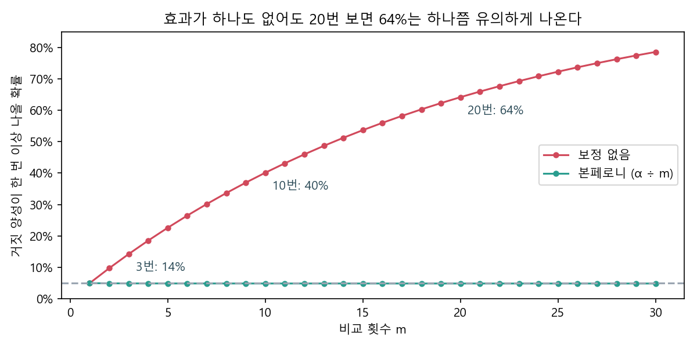
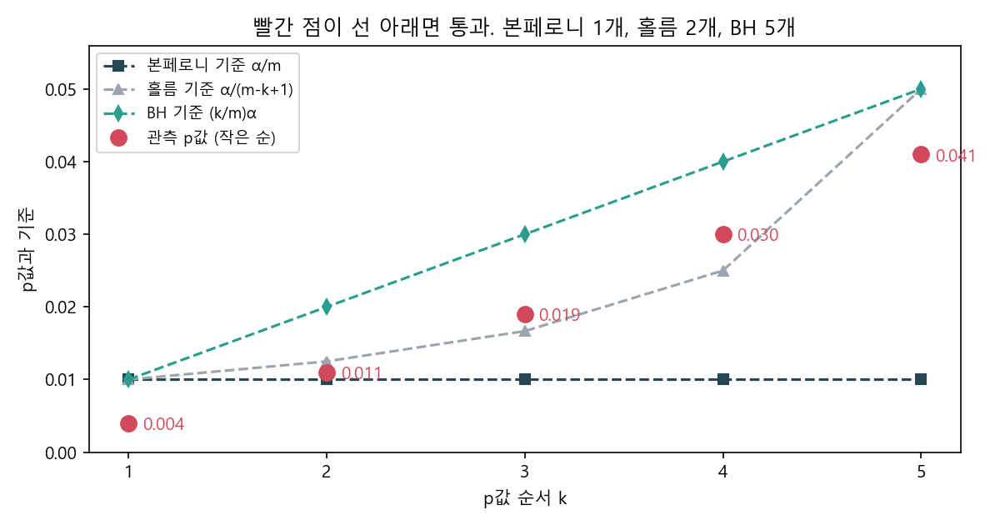
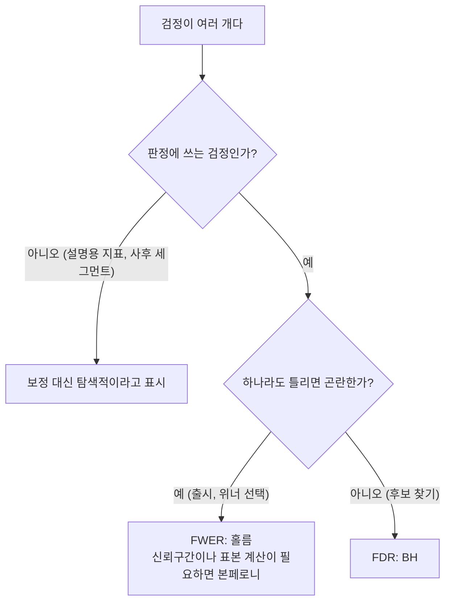

# 다중 비교 보정

> **한 줄 요약** 검정을 여러 번 하면 그중 하나라도 우연히 유의하게 나올 확률이 빠르게 커진다. 그래서 무엇을 통제할지(FWER 또는 FDR)를 실험 전에 정하고, 그에 맞는 보정을 쓴다. 보정보다 먼저 할 일은 비교 횟수 자체를 줄이는 것이다.

## 언제 쓰나

- A, B, C처럼 실험안이 둘 이상이라 비교가 여러 개 생길 때
- 1차 지표 하나에 2차 지표를 열댓 개 같이 볼 때
- 결과를 신규와 기존, 앱과 웹, 연령대별로 나눠 볼 때
- 리뷰에서 "지표를 이렇게 많이 봤는데 보정은 했나"라는 질문을 받았을 때

어느 경우든 검정을 여러 번 한다는 점에서 같은 문제다.

## 판단 기준

### 1. 5%가 왜 14%가 되나

유의수준 5%는 검정 하나에 대한 약속이다. 효과가 하나도 없는 비교를 m번 하면, 한 번이라도 거짓 양성이 나올 확률은 이렇게 된다.

$$
P(\text{거짓 양성 1번 이상}) = 1 - (1 - \alpha)^m
$$

| 비교 횟수 m | 한 번이라도 거짓 양성이 나올 확률 |
|---|---|
| 1 | 5.0% |
| 3 | 14.3% |
| 5 | 22.6% |
| 10 | 40.1% |
| 20 | 64.2% |



효과가 전혀 없는 검정 20개를 10만 번 시뮬레이션해도 64.0%가 나온다. 2차 지표 스무 개 중 하나가 유의하게 올랐다는 보고는 그것만으로는 거의 정보가 없다.

### 2. 무엇을 막을지부터 정한다

| | FWER | FDR |
|---|---|---|
| 막는 것 | 거짓 양성이 한 번이라도 나올 확률 | 양성이라고 판정한 것 중 거짓의 비율(기댓값) |
| 성격 | 엄격하다. 하나라도 틀리면 곤란할 때 | 너그럽다. 후보를 넓게 찾을 때 |
| 대표 방법 | 본페로니, 홀름 | 벤저민니-호흐베르크(BH) |
| 어울리는 상황 | 출시 결정, 여러 안 중 위너 고르기 | 지표나 세그먼트 탐색, 다음 실험 후보 찾기 |

틀렸을 때 비용이 큰 결정에는 FWER을 쓰고, "어디를 더 파 볼까"를 고르는 탐색에는 FDR을 쓴다. 이 선택은 결과를 보기 전에 설계서에 적는다.

### 3. 같은 p값, 세 가지 결론

비교 다섯 개에서 p값이 0.004, 0.011, 0.019, 0.030, 0.041이 나왔다(α = 0.05). 보정 없이 보면 다섯 개 모두 유의하다.

| 방법 | 절차 | 통과 |
|---|---|---|
| 보정 없음 | 모두 0.05와 비교 | 5 |
| 본페로니 | 모두 0.05 ÷ 5 = 0.01과 비교 | 1 |
| 홀름 | 작은 순서대로 0.05/5, 0.05/4, 0.05/3 …과 비교하다 처음 실패하면 멈춤 | 2 |
| BH | k번째 p값을 (k/5) × 0.05와 비교, 만족하는 가장 큰 k까지 모두 통과 | 5 |



홀름에서 세 번째 p값 0.019는 기준 0.0167을 넘어서 여기서 멈춘다. 다섯 번째 0.041이 기준선 아래에 있어도 이미 멈춘 뒤라 통과가 아니다. BH는 큰 쪽부터 보기 때문에 다섯 번째가 기준 0.05를 만족하는 순간 그 아래가 전부 통과한다.

같은 숫자로 1개도 5개도 만들 수 있다. 보정 방법을 결과를 보고 고르면 결론을 고르는 것과 같아진다.

### 4. 보정을 걸 지표와 안 걸 지표

모든 지표에 똑같이 보정을 거는 게 답은 아니다. 지표가 판정에서 맡는 역할에 따라 다르다.

| 지표 역할 | 판정 방식 | 보정 |
|---|---|---|
| 1차 지표 (하나) | 이걸로 위너를 고른다 | 하나면 필요 없음 |
| 성공 지표 (여러 개) | 이 중 하나라도 좋아지면 출시 | α를 나눠야 한다 |
| 가드레일 | 나빠지지 않았는지만 본다 | α 보정 대상이 아니다. 대신 놓칠 위험(검정력)을 지표 수만큼 챙긴다 |
| 설명용 2차 지표 | 판정에 안 쓴다 | 보정 대신 "탐색적"이라고 표시 |

가드레일은 "모두 괜찮아야 출시"라서, 하나라도 잘못 걸리면 오히려 출시를 막는 쪽으로 작동한다. 그래서 거짓 양성보다 진짜 악화를 놓치는 쪽이 더 문제고, 표본 계산에서 그 점을 반영한다.

## 핵심 패턴

### 세 가지 보정을 코드로

```python
from playbook import bonferroni, holm, benjamini_hochberg

p = [0.004, 0.011, 0.019, 0.030, 0.041]
reject, p_adj = bonferroni(p)          # 통과 1개, 보정 p값 [0.02, 0.055, 0.095, 0.15, 0.205]
reject, p_adj = holm(p)                # 통과 2개, 보정 p값 [0.02, 0.044, 0.057, 0.06, 0.06]
reject, p_adj = benjamini_hochberg(p)  # 통과 5개, 보정 p값 [0.02, 0.0275, 0.0317, 0.0375, 0.041]
```

보정 p값은 원래 α(0.05)와 바로 비교하면 되는 값이다. 결과표에는 원래 p값과 보정 p값을 같이 적고, 어떤 방법을 썼는지 한 줄 남긴다. 세 함수 모두 statsmodels `multipletests`와 같은 값을 내는지 테스트로 맞춰 봤다.

홀름의 보정 p값은 k번째로 작은 p값에 (m − k + 1)을 곱한 뒤 앞 순서보다 작아지지 않게 누적 최댓값을 잡은 것이다. 본페로니보다 항상 같거나 더 많이 잡으면서 FWER은 그대로 지키니, FWER이 목표라면 본페로니를 고집할 이유가 별로 없다.

$$
\tilde{p}_{(k)}^{\text{Holm}} = \max_{j \le k} \min\left(1, (m - j + 1)\, p_{(j)}\right), \qquad
\tilde{p}_{(k)}^{\text{BH}} = \min_{j \ge k} \min\left(1, \frac{m}{j}\, p_{(j)}\right)
$$

다만 본페로니는 신뢰구간을 같이 내기 쉽고(구간을 1 − α/m 수준으로 넓히면 된다), 표본 계산에 그대로 넣을 수 있다는 장점이 있다. 실험 플랫폼에서 본페로니를 기본으로 두는 경우가 많은 것도 이 때문이다.

### A, B, C 세 안을 실험할 때

1. 실무에서 궁금한 건 대부분 "새 안들이 기존안보다 나은가"다. 모든 쌍(A−B, A−C, B−C)을 비교하지 말고 대조군 대비 비교만 한다. 세 안이면 비교가 3번에서 2번으로 준다
2. 그룹이 넷 이상이고 모든 쌍이 궁금하면, 먼저 전체 검정(비율은 카이제곱, 연속형은 분산분석)으로 어디든 차이가 있는지 보고 쌍별 비교에 보정을 건다
3. 실험 전에 보정한 α로 표본을 다시 계산한다

세 번째가 자주 빠진다. 대조군 10%, MDE +1%p, 검정력 0.8 기준으로 보면

| 설계 | 쌍마다 α | 그룹당 표본 | 전체 표본 |
|---|---|---|---|
| A/B (비교 1번) | 5% | 14,749 | 29,498 |
| A/B/C, 대조군 대비만 (비교 2번) | 2.5% | 17,860 | 53,580 |

```python
from playbook import sample_size_per_group, days_needed

n = sample_size_per_group(p0=0.10, mde=0.01, alpha=0.05 / 2)   # 17,860
days_needed(n, daily_assigned_total=5_000, n_groups=3)          # 11일 (A/B면 6일)
```

arm 하나를 더하면 그룹 수가 늘어서 한 번, 기준이 엄격해져서 또 한 번 표본이 늘어난다. 하루 5천 명이 들어오는 서비스라면 6일짜리 실험이 11일이 된다.

### 비교를 처음부터 줄이는 방법

- 1차 지표를 하나로 고정하고 판정은 그 지표로만 한다
- 보고 싶은 하위그룹은 실험 전에 설계서에 적는다. 결과를 보고 나서 나눈 하위그룹은 "탐색적 결과"로 따로 표시한다
- 가드레일은 "나빠지지 않았나"만 보고, 위너를 고르는 비교와 섞지 않는다
- 탐색에서 나온 후보는 다음 실험의 가설로 넘긴다. 같은 데이터로 다시 확인하지 않는다



## 안티패턴

1. **2차 지표 중 유의한 것만 골라 성과로 보고한다** 지표를 스무 개 보면 효과가 없어도 64% 확률로 하나쯤은 유의하게 나온다. 1차 지표가 움직이지 않았다면 2차 지표의 유의함은 다음 실험 가설로만 쓴다.
2. **결과를 보고 나서 하위그룹을 쪼갠다** 전체 효과가 없을 때 "그래도 이 세그먼트에서는 올랐다"는 발견은 쪼갠 횟수만큼 우연일 가능성이 커진다. 결과 공유 직후 세그먼트별 표를 추가로 요청받는 일이 흔한데, 그럴 때는 사전에 정한 세그먼트와 사후에 나눈 세그먼트를 표에서 나눠 적어 두는 편이 안전하다.
3. **보정 방법을 결과를 보고 고른다** 같은 p값으로 본페로니는 1개, BH는 5개가 나온다. 방법은 FWER과 FDR 중 무엇을 막을지에서 정해지고, 그 결정은 설계서에 먼저 적는다.
4. **본페로니를 기계적으로 쓴다** FWER이 목표면 홀름이 같은 보장을 하면서 더 많이 잡는다. 탐색이 목적이면 애초에 FWER보다 FDR이 맞다. 본페로니를 쓴다면 신뢰구간이나 표본 계산처럼 이유가 있을 때다.
5. **arm을 늘리고 표본은 그대로 둔다** 그룹당 표본이 줄고 기준까지 엄격해져서 진짜 효과도 놓치기 쉬워진다. 보정한 α로 표본을 다시 계산하면 6일 실험이 11일이 되는 식이라, arm을 늘릴지부터 다시 따진다.
6. **가드레일에도 성공 지표와 같은 보정을 건다** 가드레일은 "모두 괜찮아야 출시"라서 α를 나누면 정작 악화를 놓칠 위험이 커진다. 가드레일은 검정력 쪽을 챙긴다.

## 더 읽을 것

- [검정력과 표본 크기](power-and-sample-size.md): 보정한 α를 넣어 표본을 다시 구한다
- [z 검정과 t 검정](z-vs-t.md): 보정 전에 쌍마다 p값을 구하는 방법
- 순차 검정, 중간에 들여다볼 때 (작성 예정): 같은 실험을 여러 번 보는 것도 다중 비교다
- 카이제곱 검정 (작성 예정)
- Holm, S. (1979). A Simple Sequentially Rejective Multiple Test Procedure. *Scandinavian Journal of Statistics*, 6(2), 65-70. [JSTOR 4615733](https://www.jstor.org/stable/4615733)
- Benjamini, Y., Hochberg, Y. (1995). Controlling the False Discovery Rate: A Practical and Powerful Approach to Multiple Testing. *JRSS Series B*, 57(1), 289-300. [doi:10.1111/j.2517-6161.1995.tb02031.x](https://doi.org/10.1111/j.2517-6161.1995.tb02031.x)
- Spotify Engineering (2024). [Risk-Aware Product Decisions in A/B Tests with Multiple Metrics](https://engineering.atspotify.com/2024/3/risk-aware-product-decisions-in-a-b-tests-with-multiple-metrics), 논문 [arXiv:2402.11609](https://arxiv.org/abs/2402.11609). 성공 지표와 가드레일을 다르게 보정하는 이유
- Kohavi, R., Tang, D., Xu, Y. (2020). *Trustworthy Online Controlled Experiments*. Cambridge University Press. 여러 지표와 하위그룹을 볼 때의 주의점
- statsmodels `multipletests` 문서

> 그림은 `scripts/make_multiple_comparisons_figures.py`로 다시 만들 수 있다. 모든 수치는 가상 시나리오다.
