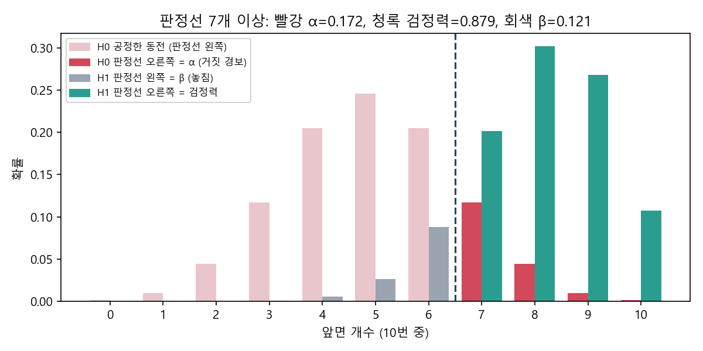
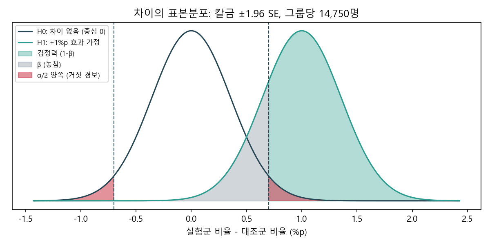
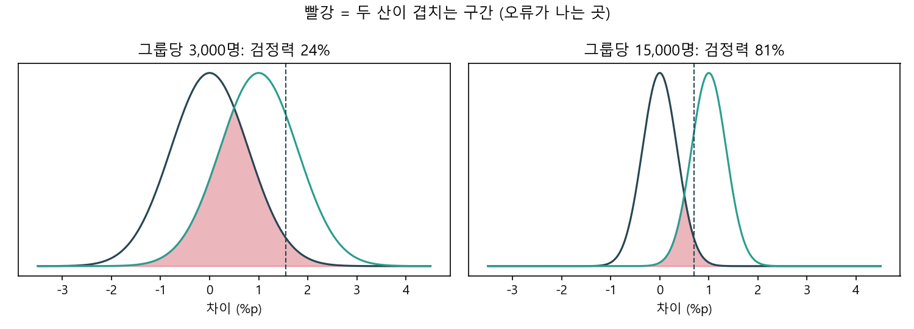
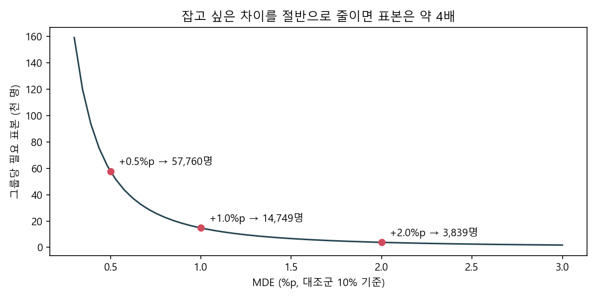

# 검정력과 표본 크기

> **한 줄 요약** 검정력은 진짜 효과가 있을 때 그걸 놓치지 않고 "효과 있다"고 잡아낼 확률(1−β)이다. 표본이 많을수록, 효과가 클수록, 잡음(분산)이 작을수록 올라간다.

## 언제 쓰나

- 실험을 시작하기 **전에** 그룹당 몇 명, 며칠이 필요한지 정할 때
- 실험이 끝났는데 결과가 유의하지 않아서 "효과가 없다"고 말해도 되는지 판단할 때
- 트래픽이 정해져 있어서 "이 기간이면 몇 %p까지 잡을 수 있나(MDE)"를 역으로 물을 때

## 판단 기준

### 1. 오류는 두 종류다: 화재경보기

| | 실제 효과 없음 (H0 참) | 실제 효과 있음 (H1 참) |
|---|---|---|
| 효과 있다고 판단 | 1종 오류 α (거짓 경보) | **검정력 1−β** (진짜 화재 감지) |
| 효과 없다고 판단 | 옳음 (1−α) | 2종 오류 β (불 났는데 조용) |

- α(유의수준)는 내가 정하는 값이다. 보통 0.05, 양측이면 z = 1.96
- β는 내가 가정한 효과 크기에 따라 정해진다
- 검정력은 보통 0.8을 목표로 한다

### 2. 그 곡선은 "무엇"의 분포인가: 표본분포

가장 흔한 오해는 H0, H1 곡선을 개별 유저나 모집단의 분포로 보는 것이다. 이 곡선은 **"실험을 하면 관측될 통계량"의 분포**다.

동전 10번으로 감을 잡으면 이렇다. 공정한 동전이면 앞면이 5개 근처(H0), 조작된 동전이면 8개 근처(H1)에 나온다. 실제 동전은 둘 중 하나지만 어느 쪽인지 모르니, "만약 공정하면"과 "만약 조작이면"을 같은 축에 겹쳐 그린다.



두 산이 겹치는 건 세계가 두 개라서가 아니다. "이 실험 결과가 어디쯤 나올까?"라는 같은 질문에 대한 두 예측을 포갠 것이고, 겹치는 6~7개 구간이 애매해서 오류가 나는 곳이다.

### 3. A/B 테스트에서는 가로축이 "차이"다

A/B에서 알고 싶은 건 B가 A보다 나은가, 즉 차이 그 자체다. 그래서 가로축이 (실험군 비율 − 대조군 비율)이 되고, "차이 없다"를 그리면 H0의 중심이 0이 된다.



| 그림 위 위치 | 뜻 |
|---|---|
| H0 중심 0 | "차이 없다"를 차이축에 그린 것 |
| H1 중심 +1%p | "효과가 +1%p 있다"고 내가 가정한 시나리오 |
| ±1.96 SE 칼금 | 양측검정 판정선 (양쪽 0.025씩) |
| 칼금을 넘는 H1 (청록) | 검정력, 효과를 제대로 잡음 |
| 칼금을 못 넘는 H1 (회색) | β, 효과가 있는데 놓침 |
| 칼금을 넘는 H0 꼬리 (빨강) | α/2, 차이 없는데 있다고 오해 |

H1이 오른쪽에 있는 건 필연이 아니라 +방향 효과를 가정했기 때문이다. 방향을 정하지 않는 양측검정이라 칼금이 양쪽에 생기고, 그게 1.96(0.025 × 2)의 정체다.

### 4. 왜 z(α)와 z(β)를 "더하나"

칼금은 하나뿐인데 두 산이 각자 요구를 한다.

- **α의 요구 (H0 입장)** 거짓 경보를 5%로 막으려면 칼금을 내 중심에서 1.96 SE 떼어 놔라
- **검정력의 요구 (H1 입장)** 놓침을 20%로 막으려면 그 칼금이 내 중심보다 0.84 SE 아래에 있어야 한다

```
H0 중심 ──[ 1.96 ]──▶ 칼금 ──[ 0.84 ]──▶ H1 중심
두 산 중심 사이 거리 = 1.96 + 0.84 = 2.8 (SE 단위)
```

두 요구는 같은 칼금의 왼쪽 구간과 오른쪽 구간을 나눠 맡는다. 겹치는 게 아니라 이어 붙는 거라서 거리가 그냥 더해진다.

## 핵심 패턴

### 표본 크기 공식: 엄격함² × 잡음 ÷ 신호²

$$
n = \frac{(z_{\alpha} + z_{\beta})^2 \times \left[p_0(1-p_0) + p_1(1-p_1)\right]}{(p_1 - p_0)^2}
$$

| 부품 | 익숙한 이름 | 넣는 값 | 커지면 |
|---|---|---|---|
| 신호 | MDE, p₁ − p₀ | 0.01 | 분모에 제곱으로 있어서 n이 급감 |
| 잡음 | 분산 p(1−p)의 합 | 0.1879 | n 증가 |
| 엄격함 | z(α) + z(β) | 1.96 + 0.84 = 2.8 | 제곱으로 n 증가 |

**예시** 대조군 10%, MDE +1%p, α 0.05, 검정력 0.8

n = 2.8² × (0.10 × 0.90 + 0.11 × 0.89) ÷ 0.01² ≈ **그룹당 1만 4,750명**. 하루 배정 인원으로 나누면 필요한 기간이 나온다.

```python
from playbook import sample_size_per_group, days_needed, mde_given_n

n = sample_size_per_group(p0=0.10, mde=0.01)          # 14,749
days_needed(n, daily_assigned_total=5_000)            # 6일
mde_given_n(p0=0.10, n_per_group=5_000)               # 이 표본으로 잡을 수 있는 최소 차이
```

### 표준오차는 검정력 쪽에서 보면 보인다

SE = √(잡음 ÷ n) → 표준화 거리 = (p₁ − p₀) ÷ SE → 검정력 = Φ(표준화 거리 − 1.96)

n을 키우면 SE가 줄고, 두 산이 뾰족해지고, 겹침이 줄어 α와 β가 함께 줄어든다. 표본 크기 공식과 검정력 공식은 같은 식을 방향만 바꾼 것이다.



### MDE가 표본과 기간을 좌우한다

분모가 (p₁ − p₀)²라서 잡고 싶은 차이를 절반으로 줄이면 표본은 약 4배가 된다. +1%p는 그룹당 약 1.5만 명, +0.5%p는 약 5.8만 명이다.



### 실무 순서

1. α를 정한다 (보통 0.05). 칼금 위치가 정해진다
2. MDE를 정한다. 근거를 붙인다 (아래 안티패턴 1)
3. 목표 검정력을 정한다 (보통 0.8)
4. n을 역산하고 하루 배정 인원으로 나눠 기간을 정한다
5. 결과가 음성이면 "이 표본으로 탐지 가능했던 최소 효과(MDE)"를 같이 보고한다

### 그룹이 3개 이상이면

A, B, C면 비교가 A−B, A−C, B−C 세 개가 된다. 각각 5%로 세 번 비교하면 한 번이라도 거짓 양성이 나올 확률이 약 14%까지 오른다. 먼저 분산분석(ANOVA)으로 "어디든 차이가 있나"를 보고, 쌍별 비교는 본페로니 보정(α ÷ 비교 횟수, 5% ÷ 3 ≈ 1.67%)처럼 칼금을 더 엄격하게 당긴다.

## 안티패턴

1. **MDE를 근거 없이 정한다** 이 값 하나가 표본과 기간을 제곱으로 흔든다. "비즈니스적으로 이 미만은 의미 없다"는 근거나 과거 실험의 효과 크기 분포로 정당화한다.
2. **p > 0.05를 "효과 없음"으로 보고한다** 검정력이 충분했을 때만 "효과가 없는 쪽에 가깝다"고 말할 수 있다. 검정력이 낮으면 "모른다"가 정답이다. 그래서 음성 결과에는 MDE와 신뢰구간 상한을 같이 쓴다.
3. **관측된 효과로 사후 검정력을 계산한다** 관측 효과로 구한 검정력은 p값과 1:1로 대응해서 새 정보가 없다(순환 논리). 미리 정한 MDE 기준으로 검정력이 충분했는지, 또는 이 표본에서 탐지 가능했던 최소 효과가 얼마였는지를 보고한다.
4. **p값만 넘으면 바로 판정한다** 검정력이 50%대인 상태에서 p값이 기준을 넘었다면, 같은 실험을 다시 돌렸을 때 결과가 뒤집힐 가능성이 크다. 실무에서 이런 실험을 계획한 표본까지 연장하자고 권한 적이 있다.
5. **arm이 여러 개인데 보정 없이 위너를 고른다** 비교가 늘수록 "우연히 이긴 것처럼 보이는" arm이 생긴다.

## 더 읽을 것

- 다중 비교 보정 (작성 예정)
- 순차 검정, 중간에 들여다볼 때 (작성 예정)
- CUPED로 잡음 줄이기 (작성 예정)

> 그림은 `scripts/make_power_figures.py`로 다시 만들 수 있다. 모든 수치는 가상 시나리오다.
