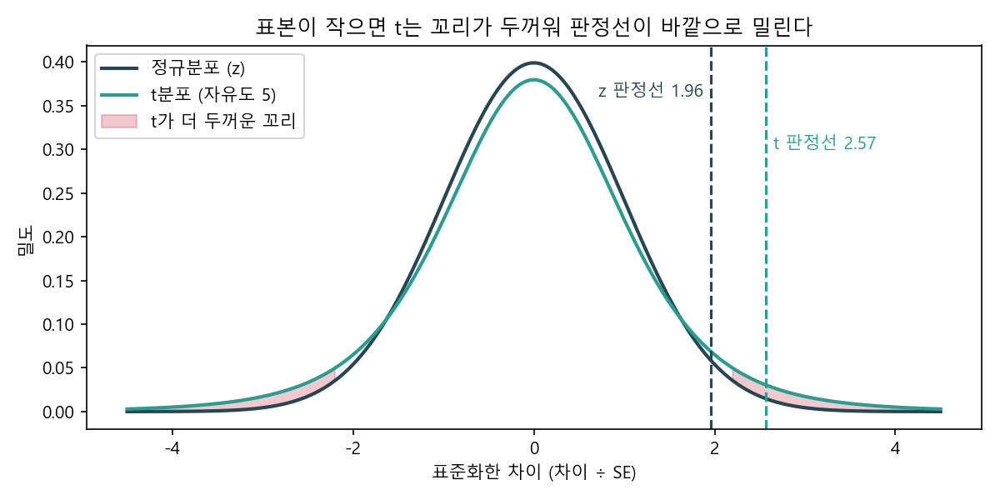
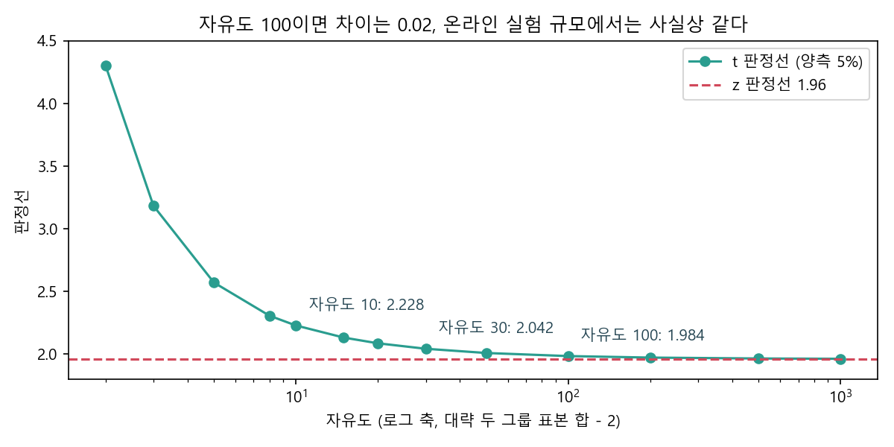
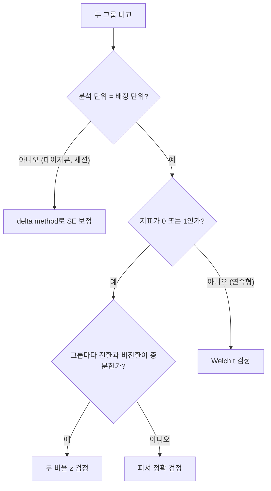

# z 검정과 t 검정

> **한 줄 요약** 두 검정은 같은 통계량(차이 ÷ SE)을 쓰고, 그 값을 정규분포에 대느냐 t분포에 대느냐만 다르다. 표본이 작으면 이 차이가 결론을 바꾸고, 온라인 실험 규모에서는 거의 사라진다. 실무에서 결론을 더 자주 바꾸는 쪽은 검정 이름보다 SE를 어떻게 잡았는지다.

## 언제 쓰나

- 실험 결과표에 어떤 검정을 써야 하는지 정할 때
- 리뷰에서 "왜 t 검정이 아니라 z 검정을 썼나"라는 질문을 받았을 때
- 표본이 수십 명 수준이라 판정선이 1.96이 맞는지 의심될 때
- 그룹 크기와 분산이 크게 다른데 등분산 t 검정을 써도 되는지 판단할 때

## 판단 기준

### 1. 두 검정은 통계량이 같다

$$
\text{통계량} = \frac{\bar{x}_1 - \bar{x}_0}{SE}
$$

| | z 검정 | t 검정 |
|---|---|---|
| 통계량 | 차이 ÷ SE | 차이 ÷ SE |
| 대보는 분포 | 표준정규분포 | 자유도 df인 t분포 |
| 판정선 (양측 5%) | 항상 1.96 | 자유도에 따라 1.96보다 크다 |
| 전제 | 표본이 커서 SE의 흔들림을 무시할 수 있다 | SE를 표본으로 추정해서 생기는 흔들림까지 반영한다 |

t분포는 "SE를 표본 표준편차로 추정했더니 그 값도 흔들린다"는 사실을 꼬리 두께로 반영한 분포다. 표본이 작을수록 꼬리가 두껍고 판정선이 바깥으로 밀린다.



### 2. 표본이 크면 판정선이 사실상 같다

| 자유도 | t 판정선 (양측 5%) | z와의 차이 |
|---|---|---|
| 10 | 2.228 | 0.268 |
| 30 | 2.042 | 0.082 |
| 100 | 1.984 | 0.024 |
| 1,000 | 1.962 | 0.002 |
| 10,000 | 1.960 | 0.000 |



그룹당 수천 명 이상인 온라인 실험에서는 z와 t의 판정선 차이가 소수 셋째 자리 아래로 내려간다. "z냐 t냐"는 표본이 수십 명일 때 결론을 바꾸는 질문이다.

### 3. 지표 종류로 고르는 기준

| 지표 | 예시 | 기본 검정 | 이유 |
|---|---|---|---|
| 비율 (유저당 0 또는 1) | 전환율, 재방문율 | 두 비율 z 검정 (또는 카이제곱) | 분산이 비율 하나로 정해진다, p(1−p) |
| 연속형 (유저당 값) | 매출, 체류 시간 | Welch t 검정 | 분산을 따로 추정해야 하고, 그룹 분산이 같다는 보장이 없다 |
| 비율인데 표본이 아주 작음 | 전환이 한 자릿수 | 피셔 정확 검정 | 정규근사가 맞지 않는다 |
| 분석 단위가 배정 단위보다 잘다 | 페이지뷰당 클릭률 | delta method로 SE를 고친 z 검정 | 같은 유저의 행동끼리 독립이 아니다 |

비율 지표의 분산도 사실은 표본 비율 p̂로 추정한 값이다. 그래도 z 검정을 쓰는 건 비율의 분산이 평균에 묶여 있어서 표본이 크면 추정 흔들림이 매우 작기 때문이다. "σ를 정확히 알아서"라기보다 "대표본 근사가 잘 맞아서"라고 이해하는 편이 정확하다.

### 4. 같은 데이터면 결론도 같다

전환율 10.0% (1,000 / 10,000)와 11.0% (1,100 / 10,000)를 비교하면

| 방법 | 통계량 | p값 |
|---|---|---|
| 두 비율 z 검정 (합동 SE) | 2.307 | 0.0211 |
| 두 비율 z 검정 (각 그룹 SE) | 2.307 | 0.0211 |
| 0과 1 데이터에 Welch t 검정 | 2.307 | 0.0211 |

이 규모에서는 어느 검정을 써도 같은 답이 나온다. 이름보다 단위와 SE가 맞는지가 먼저다.

## 핵심 패턴

### 비율 지표: 두 비율 z 검정

$$
z = \frac{\hat{p}_1 - \hat{p}_0}{\sqrt{\hat{p}(1-\hat{p})\left(\frac{1}{n_0} + \frac{1}{n_1}\right)}}, \quad \hat{p} = \frac{x_0 + x_1}{n_0 + n_1}
$$

검정은 "차이 없다"가 전제라서 두 그룹을 합친 비율(합동 SE)을 쓰고, 신뢰구간은 그룹별 비율로 SE를 잡는다.

```python
from playbook import two_proportion_ztest

two_proportion_ztest(x0=1_000, n0=10_000, x1=1_100, n1=10_000)   # (2.307, 0.0211)
```

### 연속형 지표: Welch t 검정을 기본값으로

$$
t = \frac{\bar{x}_1 - \bar{x}_0}{\sqrt{\frac{s_0^2}{n_0} + \frac{s_1^2}{n_1}}}
$$

자유도는 Welch-Satterthwaite 근사로 구한다. 두 그룹 분산이 같으면 등분산 t 검정과 거의 같은 답을 주고, 다르면 등분산 t 검정보다 안전하다. 그래서 고민하지 말고 Welch를 기본으로 둔다.

```python
from playbook import welch_ttest, student_ttest, critical_value

# 작은 표본: 그룹당 10명, 평균 50 vs 58, 표준편차 9
welch_ttest(50, 9, 10, 58, 9, 10)        # t = 1.988, 자유도 18, p = 0.062
critical_value(df=18)                     # 2.101, z로 보면 1.96이라 p = 0.047

# 크기와 분산이 다른 그룹: 1,000명 sd 10 vs 100명 sd 30
welch_ttest(100, 10, 1_000, 104, 30, 100)    # p = 0.188
student_ttest(100, 10, 1_000, 104, 30, 100)  # p = 0.004, 작은 그룹의 큰 분산을 놓친다
```

### 고르는 순서



## 안티패턴

1. **z와 t 선택에 시간을 쓰고 분석 단위는 안 본다** 그룹당 수천 명이면 두 검정 차이는 소수 셋째 자리다. 결론을 바꾸는 건 페이지뷰를 독립 표본처럼 세서 SE를 작게 잡는 실수 쪽이다. 배정 단위와 분석 단위부터 맞춘다.
2. **표본이 수십 명인데 1.96을 쓴다** 자유도 18이면 판정선은 2.101이다. 같은 데이터로 z는 p = 0.047, t는 p = 0.062가 나와서 판정이 뒤집힌다. 소규모 파일럿이나 B2B 고객 단위 분석에서 자주 생긴다.
3. **그룹 크기와 분산이 다른데 등분산 t 검정을 쓴다** 큰 그룹의 작은 분산에 끌려 SE가 작아진다. 위 예시에서 Welch는 p = 0.188, 등분산 t는 p = 0.004다. 일부 유저만 노출되는 실험이나 고액 결제가 한쪽에 몰린 매출 지표에서 생긴다.
4. **"비율은 σ를 알아서 z"라고 외운다** 비율의 분산도 표본으로 추정한다. z를 쓰는 근거는 대표본 근사다. 이걸 놓치면 전환이 몇 건뿐인 작은 표본에도 z를 그대로 써서 정규근사가 깨진 줄 모른다.
5. **도구마다 다른 SE를 섞어 보고한다** 검정은 합동 SE, 신뢰구간은 그룹별 SE를 쓰는 게 교과서 방식이라 p값과 신뢰구간 끝이 아주 조금 어긋날 수 있다. 보고서에 어떤 SE를 썼는지 한 줄로 적어 둔다.

## 더 읽을 것

- [검정력과 표본 크기](power-and-sample-size.md): 같은 z 통계량으로 필요한 표본을 거꾸로 구한다
- 건수 기준 지표와 delta method (작성 예정)
- 등분산과 Welch t 검정 (작성 예정)
- 카이제곱 검정 (작성 예정)
- Welch, B. L. (1947). The generalization of Student's problem when several different population variances are involved. *Biometrika*, 34. [doi:10.1093/biomet/34.1-2.28](https://doi.org/10.1093/biomet/34.1-2.28)
- Kohavi, R., Tang, D., Xu, Y. (2020). *Trustworthy Online Controlled Experiments*. Cambridge University Press. 분석 단위와 분산 추정 장
- Deng, A., Knoblich, U., Lu, J. (2018). Applying the Delta Method in Metric Analytics. [arXiv:1803.06336](https://arxiv.org/abs/1803.06336)
- statsmodels `proportions_ztest`, scipy `ttest_ind(equal_var=False)` 문서

> 그림은 `scripts/make_z_vs_t_figures.py`로 다시 만들 수 있다. 모든 수치는 가상 시나리오다.
