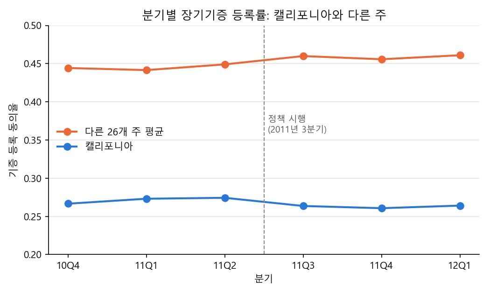
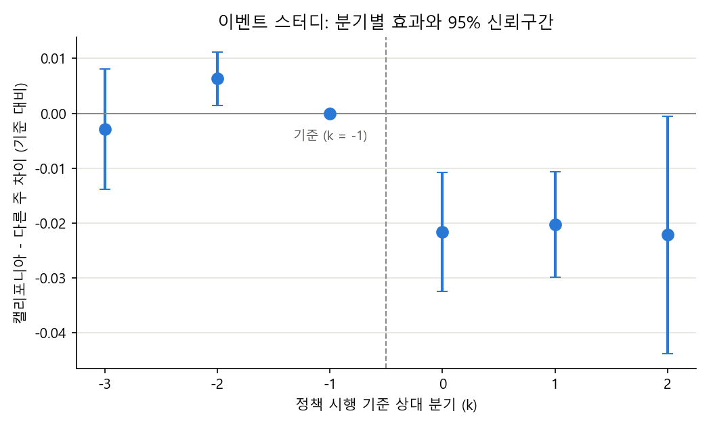
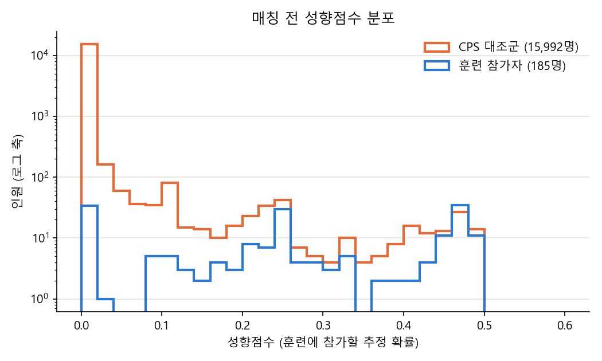
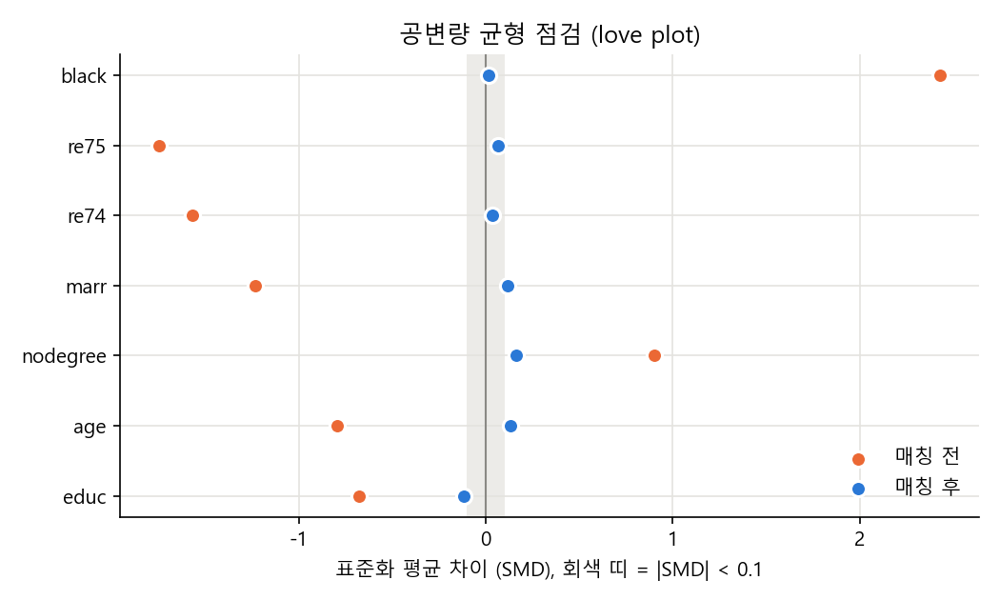

# 무작위 배정 없이 효과 추정하기: DID와 PSM

기능을 한 지역에만 먼저 배포했거나 유저가 스스로 기능을 골라 쓴 경우에는 A/B 테스트처럼 무작위로 나눈 대조군이 없습니다. 그래도 "그 변화가 지표를 얼마나 움직였나"에는 답해야 해서, 이럴 때 쓰는 대표 방법 두 가지가 실제로 정답에 얼마나 가까운지 궁금했습니다. 그래서 공개 데이터 두 개로 논문 결과를 다시 계산해 봤습니다.

두 방법은 쓰는 상황이 조금 다릅니다. DID는 처치가 특정 시점에 특정 집단에만 들어갔을 때("언제 무엇이 바뀌었나") 쓰고, PSM은 처치를 받은 사람이 스스로 선택했을 때("누가 그 행동을 했나") 씁니다.

## 결과 먼저

DID로는 캘리포니아의 "능동적 선택" 기증 등록 방식이 등록 동의율을 **-0.0225 (약 -2.25%p)** 바꾼 것으로 추정했습니다. 주 단위 클러스터 표준오차는 0.0061, p = 0.0002이고, 2x2 손계산과 회귀 계수가 같게 나왔습니다. 정책 전 세 분기 격차는 -0.178, -0.168, -0.175로 거의 일정했습니다. 다만 이벤트 스터디의 k = -2 계수(+0.0063)는 신뢰구간이 0을 살짝 벗어났습니다.

PSM에서는 단순 비교가 **-$8,498**로 부호까지 틀렸는데, 1:1 최근접 매칭 후 ATT는 **+$1,775**로 실험 정답 **+$1,794**에 가까웠습니다. 매칭 후 7개 공변량의 |SMD|는 모두 0.17 이하로 줄었습니다.

다만 PSM 추정치는 성향점수 모델에 꽤 민감했습니다. 공변량 구성만 바꿔도 +$1,551에서 +$2,074까지 움직여서, 숫자 하나보다 사양별 범위를 같이 보고해야겠다고 느꼈습니다.

## 어떻게 했나

두 방법 모두 "처치를 받지 않았다면 어땠을지(반사실)"를 대조군으로 채우는 방식입니다. 채우는 방법과 필요한 가정이 다릅니다.

### DID

미국 27개 주의 분기별 장기기증 등록 동의율 데이터를 썼습니다 (2010년 4분기에서 2012년 1분기, 6분기). 캘리포니아가 2011년 3분기에 등록 문구를 "능동적 선택" 방식으로 바꿨고, 정책을 바꾸지 않은 나머지 26개 주를 대조군으로 두었습니다.

1. 먼저 2x2 표를 만들었습니다. 집단(처치, 대조)과 기간(전, 후)별 평균을 구하고 두 번 뺍니다.

$$
\text{DID} = (\bar{Y}_{\text{처치, 후}} - \bar{Y}_{\text{처치, 전}}) - (\bar{Y}_{\text{대조, 후}} - \bar{Y}_{\text{대조, 전}})
$$

2. 같은 값을 회귀의 상호작용항 계수로도 구했습니다. 같은 주가 여러 분기 관측되기 때문에 주 단위 클러스터 표준오차를 썼습니다.

```
Rate ~ Treated + Post + Treated:Post      # Treated:Post 계수 = DID
```

3. 사전 추세를 확인하려고 정책 전 세 분기의 집단별 기울기와 분기별 격차를 봤습니다.
4. 이벤트 스터디도 돌렸습니다. 주 고정효과와 분기 고정효과를 넣고, 정책 직전 분기(k = -1)를 기준으로 분기마다 처치군과 대조군의 차이를 따로 추정했습니다.

$$
Y_{it} = \alpha_i + \lambda_t + \sum_{k \neq -1} \delta_k \cdot \text{Treated}_i \cdot \mathbb{1}(t - t_0 = k) + \varepsilon_{it}
$$

k < 0 의 계수가 0 근처면 평행 추세를 지지하는 증거로 볼 수 있습니다.

### PSM

LaLonde(1986)의 NSW 직업훈련 데이터 중 Dehejia & Wahba(1999) 표본을 썼습니다. NSW는 원래 무작위 배정 실험이라 실험 정답이 있다는 점이 좋았습니다. 실험 대조군 대신 일반 인구 표본(CPS) 15,992명을 대조군으로 붙여서, 관측 데이터 방법이 정답을 얼마나 되찾는지 시험해 봤습니다.

1. 실험 정답은 NSW 처치군 185명과 실험 대조군 260명의 1978년 소득 평균 차로 잡았습니다.
2. 비교용으로 NSW 처치군 185명과 CPS 15,992명의 단순 평균 차도 구했습니다.
3. 성향점수는 로지스틱 회귀로 훈련 참가 확률을 추정했습니다. 공변량은 나이(age), 교육 연수(educ), 흑인 여부(black), 결혼(marr), 무학위(nodegree), 1974년 소득(re74), 1975년 소득(re75)입니다.

$$
e(X) = P(T = 1 \mid X)
$$

4. 처치군 한 명마다 성향점수가 가장 가까운 CPS 대조군 1명을 골랐습니다 (1:1, 복원 매칭, 캘리퍼 없음).
5. 균형은 공변량마다 매칭 전후 표준화 평균 차이(SMD)를 계산해서 봤고, |SMD| < 0.1 을 균형 기준으로 삼았습니다.

$$
\text{SMD} = \frac{\bar{X}_{\text{처치}} - \bar{X}_{\text{대조}}}{\sqrt{(s^2_{\text{처치}} + s^2_{\text{대조}}) / 2}}
$$

6. ATT는 처치군 평균 소득에서 매칭된 대조군 평균 소득을 뺀 값입니다.
7. 마지막으로 사양 민감도를 봤습니다. hisp 추가, 제곱항(age, educ)과 무소득 더미(re74 = 0, re75 = 0) 추가로 모두 4개 사양의 ATT를 비교했습니다.

## 자세한 결과

아래 숫자는 모두 run.py를 돌려서 `outputs/results.md`에 나온 값을 옮겼습니다.

### DID



| 집단 | 정책 전 | 정책 후 | 전후 변화 |
|---|---|---|---|
| 대조군 (다른 26개 주) | 0.4449 | 0.4589 | +0.0139 |
| 처치군 (캘리포니아) | 0.2713 | 0.2628 | -0.0085 |
| **DID** | | | **-0.0225** |

회귀의 `Treated:Post` 계수는 -0.0225, 클러스터 SE 0.0061, p = 0.0002였습니다. 두 집단의 수준은 0.45 대 0.27로 크게 다르지만, 첫 번째 차분에서 지워지기 때문에 문제가 되지 않습니다. 정책 전 분기당 기울기는 캘리포니아 +0.0038, 다른 주 +0.0024였습니다.



| k | 계수 | 95% CI |
|---|---|---|
| -3 | -0.0029 | [-0.0139, +0.0080] |
| -2 | +0.0063 | [+0.0014, +0.0112] |
| -1 | 0 (기준) | |
| 0 | -0.0216 | [-0.0324, -0.0107] |
| 1 | -0.0203 | [-0.0299, -0.0107] |
| 2 | -0.0222 | [-0.0437, -0.0006] |

캘리포니아만 보면 정책 후 0.85%p 떨어졌습니다. 같은 기간 다른 주는 1.39%p 올랐으니, 정책이 없었다면 캘리포니아도 비슷하게 올랐을 것으로 봤고, 그 차이인 -2.25%p를 정책 효과로 해석했습니다. 이벤트 스터디에서 정책 후 세 분기 계수가 모두 -0.020에서 -0.022로 비슷해서, 효과가 한 분기에 몰린 게 아니라 꾸준히 이어진 것으로 보입니다.

평행 추세는 완벽하지 않았습니다. 정책 전 캘리포니아가 조금 더 가파르게 오르고 있었고(+0.0038 대 +0.0024), k = -2 계수는 0과 통계적으로 구분됐습니다. 다만 캘리포니아가 더 빨리 오르던 흐름이 이어졌다면 반사실은 더 높았을 테니, 이 어긋남은 효과를 작게 잡는 방향입니다. 그래서 -2.25%p는 보수적인 추정에 가깝다고 판단했습니다.

### PSM



CPS 대조군 대부분은 성향점수 0 근처에 몰려 있고, 훈련 참가자는 0.2에서 0.5에 퍼져 있었습니다. 일반 인구 중에 훈련 참가자와 닮은 사람이 드물다는 뜻입니다. 실제로 매칭에 쓰인 서로 다른 대조군은 133명뿐이었습니다.

| 방법 | ATT (1978년 소득) | 의미 |
|---|---|---|
| 실험 정답 (무작위 배정) | +$1,794 | 기준값 |
| 단순 관측 비교 | -$8,498 | 부호까지 틀림 |
| PSM 1:1 최근접 | +$1,775 | 정답과 $19 차이 |



| 공변량 | 매칭 전 SMD | 매칭 후 SMD |
|---|---|---|
| black | +2.428 | +0.015 |
| re75 | -1.746 | +0.065 |
| re74 | -1.569 | +0.034 |
| marr | -1.233 | +0.116 |
| nodegree | +0.904 | +0.161 |
| age | -0.796 | +0.132 |
| educ | -0.679 | -0.119 |

매칭 전에는 대부분 |SMD|가 0.5를 넘었는데, 매칭 후에는 크게 줄었습니다. 그래도 nodegree, age, educ, marr 네 개는 0.1을 넘어서, 균형이 일부 덜 맞은 상태의 추정치라는 점은 감안해야 합니다.

| 성향점수 모델 | ATT |
|---|---|
| 기본 7개 공변량 | +$1,775 |
| 기본 7개 + hisp | +$1,551 |
| 기본 7개 + 제곱항, 무소득 더미 | +$2,074 |
| 기본 7개 + hisp + 제곱항, 무소득 더미 | +$1,825 |

네 사양 모두 단순 비교(-$8,498)보다는 정답에 훨씬 가깝지만, 서로 $500 넘게 차이가 났습니다. 대조군이 0 근처에 몰려 있어서 매칭될 수 있는 사람이 적고, 모델을 조금만 바꿔도 짝이 달라지기 때문으로 보입니다. 그럼에도 PSM이 이 정도까지 맞은 건 과거 소득(re74, re75)이 개인의 능력과 상황을 상당 부분 담고 있어서라고 추정했습니다.

## 아쉬운 점과 다음에 해 볼 것

DID의 처치군이 캘리포니아 하나뿐이라는 점이 가장 걸렸습니다. 처치 클러스터가 1개면 클러스터 표준오차가 실제 불확실성을 작게 잡을 수 있습니다. 다음에는 대조 주를 하나씩 처치군으로 바꿔 보는 위약(placebo) 검정이나 합성 대조군(synthetic control)을 해 보려고 합니다. 사전 기간도 세 분기뿐이라 평행 추세의 근거가 약하고, 같은 시기 캘리포니아에만 있었던 다른 변화는 이 데이터로 배제하지 못했습니다.

PSM은 측정한 변수만 맞출 수 있어서, 의욕처럼 데이터에 없는 교란은 보정하지 못합니다. 이번에는 Rosenbaum bounds 같은 민감도 분석을 붙이지 못했습니다. PSM 표준오차와 신뢰구간도 계산하지 않았는데, 복원 매칭이라 단순 t검정은 맞지 않고 부트스트랩이나 Abadie-Imbens 표준오차가 필요합니다.

균형이 덜 맞은 변수도 남아 있습니다. 캘리퍼 매칭, 역확률 가중(IPW), 회귀 보정을 더해서 사양별 범위가 좁혀지는지 보는 게 다음 단계입니다.

이번에는 실험 정답이 있는 데이터라 PSM이 정답에 가까운지 확인할 수 있었지만, 실무 데이터에는 정답이 없습니다. 그래서 실무에서는 사양 민감도와 균형표를 함께 보고하는 습관이 더 중요하다고 생각하게 됐습니다.

## 직접 돌려 보기

```
pip install -r ../../requirements.txt
python run.py
python -m pytest tests
```

run.py를 돌리면 `data/`의 csv 세 개를 읽어서 `outputs/`에 그림 4개와 표(csv, `results.md`)가 생깁니다. 일반 노트북에서 10초 안에 끝납니다. 데이터 처리에 난수를 쓰지 않아서 실행할 때마다 같은 숫자가 나옵니다. tests에서는 합성 데이터에 넣은 효과(DID -0.03, PSM +2.0)를 함수가 제대로 되찾는지 확인했습니다.

### 데이터 출처와 라이선스

| 파일 | 내용 | 출처 |
|---|---|---|
| `data/organ_donations.csv` | 27개 주 x 6분기 등록률 (162행) | Kessler, J.B. and Roth, A.E. (2014), "Don't Take 'No' for an Answer: An Experiment with Actual Organ Donor Registrations", NBER Working Paper 20378. Huntington-Klein, *The Effect* DID 장에서 쓰는 정리본 |
| `data/nsw_mixtape.csv` | NSW 실험 표본 445명 (처치 185, 실험 대조 260) | LaLonde (1986), Dehejia and Wahba (1999) 표본. Cunningham, *Causal Inference: The Mixtape* 정리본 |
| `data/cps_mixtape.csv` | CPS 비실험 대조군 15,992명 | Dehejia and Wahba (1999)의 CPS-1 표본. 같은 Mixtape 정리본 |

- 세 파일 모두 Python 패키지 `causaldata` 0.1.5 (PyPI, Nick Huntington-Klein, MIT 라이선스)에 들어 있는 사본이다. 장기기증은 원본 csv를 그대로 복사했고, NSW와 CPS는 Stata `.dta` 파일을 열 이름과 값 그대로 csv로 바꿨다.
- 원 데이터의 저작권은 각 논문 저자에게 있다. 패키지의 MIT 라이선스는 패키지 배포에 대한 것이며, 이 폴더는 교육용 재현 목적으로 사본을 둔다.

## 참고한 자료

- Kessler, J.B. and Roth, A.E. (2014). Don't Take 'No' for an Answer. NBER WP 20378. https://www.nber.org/papers/w20378
- LaLonde, R. (1986). Evaluating the Econometric Evaluations of Training Programs with Experimental Data. *American Economic Review*, 76(4).
- Dehejia, R. and Wahba, S. (1999). Causal Effects in Nonexperimental Studies: Reevaluating the Evaluation of Training Programs. *JASA*, 94(448).
- Rosenbaum, P. and Rubin, D. (1983). The Central Role of the Propensity Score in Observational Studies for Causal Effects. *Biometrika*, 70(1).
- Huntington-Klein, N. *The Effect*, 18장 Difference-in-Differences. https://theeffectbook.net
- Cunningham, S. *Causal Inference: The Mixtape*, Matching and Subclassification 장, Difference-in-Differences 장. https://mixtape.scunning.com
- causaldata 패키지: https://pypi.org/project/causaldata/
