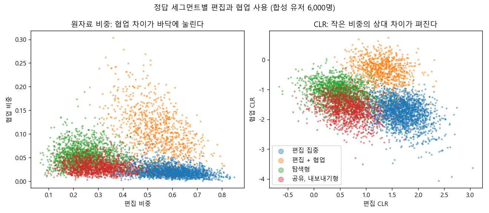
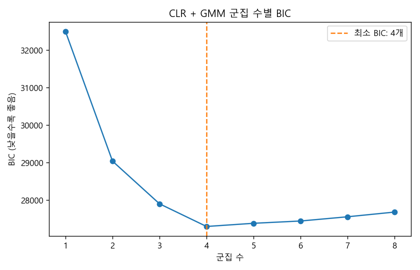
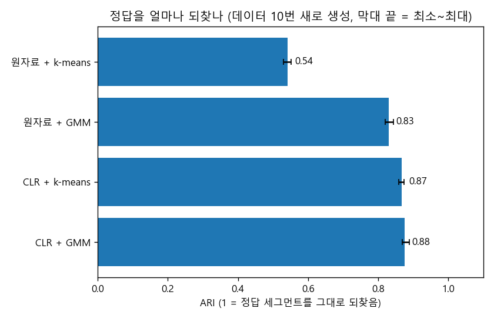
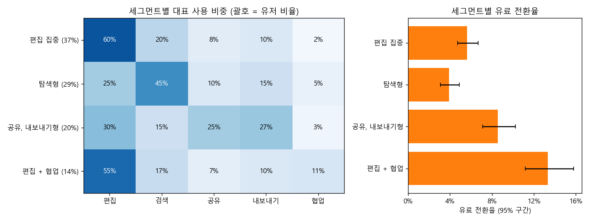

# 기능 사용 비중 세그먼테이션 (CLR + GMM)

> 한 줄 요약: 합이 1인 기능 사용 비중으로 유저를 나눌 때 원자료를 그대로 k-means에 넣어도 되는지 묻는다. 정답을 심은 합성 데이터에서 원자료 k-means는 ARI 0.54, CLR 변환 뒤 GMM은 0.88이었고, BIC는 정답 군집 수 4를 골랐다.

## 질문
"어떤 유저가 어떤 기능을 주로 쓰나"로 세그먼트를 만들 때, 사용량 자체보다 사용 비중(기능별 횟수 / 전체 횟수)을 쓰는 경우가 많다. 헤비 유저와 라이트 유저를 같은 기준으로 비교하려는 것이다.
그런데 비중은 합이 1로 묶인 조성 데이터라서, 보통의 숫자 열처럼 유클리드 거리로 다루면 작은 비중에서 생기는 의미 있는 차이를 놓친다.
이 프로젝트는 그 문제를 합성 데이터로 보여 주고, CLR 변환과 GMM으로 정답 세그먼트를 얼마나 되찾는지 잰다.

## 결론
- 기능 5종 사용 비중을 가진 합성 유저 6,000명(정답 세그먼트 4개)에서 CLR + GMM의 BIC는 군집 4개에서 가장 낮았다.
- 데이터를 시드만 바꿔 10번 새로 만든 평균 ARI: 원자료 + k-means 0.54, 원자료 + GMM 0.83, CLR + k-means 0.87, CLR + GMM 0.88. 차이의 대부분은 CLR 변환에서 나온다.
- 원자료 k-means는 "편집 집중" 세그먼트를 편집 비중의 높낮이로 둘로 쪼개고(777명, 1,360명), 협업 비중만 다른 "편집 + 협업" 세그먼트(879명)를 그 두 군집에 반씩 흩었다.
- CLR + GMM이 찾은 세그먼트의 유료 전환율은 3.9%에서 13.3%까지 달랐다(카이제곱 90.1, 자유도 3, p = 2.1e-19). 전환율이 가장 높은 "편집 + 협업"(13.3%)은 원자료 k-means로는 보이지 않던 세그먼트다.
- 유저당 사용 횟수가 적으면(평균 30회) 0회 칸이 10%가 되고 CLR + GMM의 ARI가 0.31로 떨어져 원자료 k-means(0.39)보다 못했다. CLR은 충분히 쓴 유저에게 쓸 방법이다.

## 방법
1. **합성 데이터**: 세그먼트 4개마다 평균 사용 비중을 정하고(`synth.SEGMENTS`), 로그 비중에 정규 잡음(표준편차 0.35)을 더해 유저별 비중을 만든다. 유저별 전체 사용 횟수(평균 500회)를 그 비중대로 다항분포로 나눠 기능별 횟수를 만든다. 세그먼트별 정답 전환율(3%, 6%, 9%, 14%)로 유료 전환 여부를 뽑는다. `data/feature_usage.csv`.
2. **원자료를 그대로 쓰면 생기는 문제**
   - 합이 1이라는 제약: 한 기능 비중이 오르면 다른 비중은 반드시 내려간다. 비중끼리 음의 상관이 데이터와 상관없이 생기고, 5개 열 중 하나는 나머지로 정해진다.
   - 상대 비율이 의미인데 거리는 절대 차이를 본다: 협업 2%와 11%는 5배 넘게 다른 사용 습관이지만 유클리드 거리로는 0.09다. 편집 55%와 64%의 차이와 같은 크기로 취급된다. 그래서 k-means는 큰 비중(편집)의 높낮이로 군집을 나누고, 작은 비중의 차이로 갈리는 세그먼트를 놓친다.
3. **0 처리와 CLR 변환**: 0회 기능은 로그를 쓸 수 없어서 횟수에 0.5를 더한 뒤 비중으로 바꾼다. 그다음 중심 로그비(CLR) 변환을 한다.
   $$\mathrm{clr}(x)_j = \log \frac{x_j}{g(x)}, \qquad g(x) = \Big(\prod_{k=1}^{D} x_k\Big)^{1/D}$$
   비율이 같으면 사용량이 달라도 값이 같고, 2% 대 11%처럼 작은 비중의 상대 차이가 log 척도에서 1.7만큼 벌어진다.
4. **GMM과 BIC**: CLR 좌표는 합이 0이라 마지막 열을 빼고 4개 열로 GMM(공분산 full, 초기값 5번)을 맞춘다. 군집 수 1~8개의 BIC를 비교해 가장 낮은 값을 고른다.
5. **비교**: 같은 군집 수로 원자료 k-means, 원자료 GMM, CLR k-means, CLR GMM을 돌리고 정답과의 일치를 ARI(adjusted Rand index, 1이면 완전 일치, 0이면 무작위 수준)로 잰다. 데이터를 10번 새로 만들어 반복한다.
6. **프로파일**: 군집별 대표 비중은 CLR 평균을 다시 비중으로 되돌린 값(조성 데이터의 기하 평균)을 쓴다. 전환율 구간은 Wilson 95% 구간, 세그먼트 간 차이는 카이제곱 검정.

## 결과



왼쪽은 원자료 비중이다. "편집 + 협업"(주황)은 위로 떠 있지만 협업 축의 범위가 0~0.3이라 k-means 거리 계산에서 편집 축(0.1~0.8)에 밀린다. 오른쪽 CLR에서는 두 축이 비슷한 척도가 되어 네 세그먼트가 각자 덩어리로 보인다.



| 군집 수 | 1 | 2 | 3 | 4 | 5 | 6 | 7 | 8 |
|---|---|---|---|---|---|---|---|---|
| BIC | 32495 | 29040 | 27902 | **27298** | 27383 | 27444 | 27556 | 27682 |



| 방법 | ARI 평균 | 최소 | 최대 |
|---|---|---|---|
| 원자료 + k-means | 0.542 | 0.530 | 0.551 |
| 원자료 + GMM | 0.830 | 0.820 | 0.844 |
| CLR + k-means | 0.867 | 0.859 | 0.873 |
| CLR + GMM | 0.876 | 0.869 | 0.889 |

원자료 GMM도 꽤 잘 되찾는다. 공분산을 자유롭게 두면 축마다 척도를 따로 맞출 수 있어서다. 그래도 CLR 두 방법보다 낮고, 핵심은 변환이다. CLR 위에서 k-means와 GMM의 차이는 작다. GMM을 쓰는 이유는 정확도보다 BIC로 군집 수를 고를 수 있고, 유저마다 소속 확률을 준다는 데 있다.

원자료 k-means가 정답을 어떻게 섞었는지(`outputs/crosstab_raw_kmeans.csv`):

| 정답 \ 찾은 군집 | 0 | 1 | 2 | 3 |
|---|---|---|---|---|
| 공유, 내보내기형 | 79 | 14 | 1,116 | 8 |
| 탐색형 | 218 | 1,469 | 44 | 0 |
| 편집 + 협업 | 451 | 6 | 3 | 419 |
| 편집 집중 | 777 | 28 | 8 | 1,360 |



CLR + GMM 세그먼트 프로파일(`outputs/segment_profile.csv`). 이름은 가장 많이 겹치는 정답 세그먼트에서 따왔다.

| 세그먼트 | 유저 수 | 비율 | 편집 | 검색 | 공유 | 내보내기 | 협업 | 전환율 (95% 구간) |
|---|---|---|---|---|---|---|---|---|
| 편집 집중 | 2,202 | 36.7% | 60% | 20% | 8% | 10% | 2% | 5.6% (4.7 ~ 6.7) |
| 탐색형 | 1,748 | 29.1% | 25% | 45% | 10% | 15% | 5% | 3.9% (3.1 ~ 4.9) |
| 공유, 내보내기형 | 1,217 | 20.3% | 30% | 15% | 25% | 27% | 3% | 8.5% (7.1 ~ 10.2) |
| 편집 + 협업 | 833 | 13.9% | 55% | 17% | 7% | 10% | 11% | 13.3% (11.2 ~ 15.8) |

전체 전환율은 6.78%다. "편집 + 협업"은 유저의 14%지만 전환율이 전체의 2배 가까이 된다.

유저당 사용 횟수에 따른 차이(`outputs/low_activity_check.csv`, 같은 시드, 군집 4개):

| 유저당 평균 사용 횟수 | 0회 칸 비율 | 원자료 + k-means | CLR + GMM |
|---|---|---|---|
| 30 | 10.3% | 0.388 | 0.308 |
| 100 | 1.6% | 0.488 | 0.548 |
| 500 | 0.0% | 0.532 | 0.887 |

## 한계와 다음 단계
- **세그먼트는 기술이지 처방이 아니다**: "편집 + 협업" 세그먼트의 전환율이 높다고 해서 협업 기능을 권하면 전환이 오른다는 뜻은 아니다. 원래 유료를 살 사람이 협업을 쓰는 것일 수 있다. 다음 단계는 세그먼트별로 실험을 설계하는 것이다. 예: "편집 집중" 유저에게 협업 기능 노출을 무작위로 늘려 전환율이 오르는지 본다.
- **사용량이 적은 유저**: 0회 칸이 많으면 pseudocount 값이 결과를 좌우하고 CLR이 잡음에 휘둘린다(위 표의 30회 줄). 실무에서는 최소 사용 횟수 이상인 유저만 세그먼트에 넣고, 나머지는 "저활동" 세그먼트로 따로 둔다. 0이 구조적으로 많다면(기능을 아예 모름) 0 여부를 별도 변수로 다루는 편이 낫다.
- **합성 데이터의 유리함**: 잡음을 로그 비중 공간에서 정규분포로 넣었기 때문에 CLR + GMM의 가정과 생성 과정이 잘 맞는다. 실제 데이터에서는 차이가 이보다 작을 수 있다.
- **군집 수는 BIC만으로 정하지 않는다**: 실제 데이터에서는 BIC가 계속 내려가는 경우가 많다. 세그먼트 수는 운영 가능한 수(팀이 다르게 대할 수 있는 수)와 함께 정한다.
- **시점 고정**: 한 시점의 비중만 썼다. 세그먼트 간 이동(예: 탐색형에서 편집 집중으로)은 보지 않았다.

## 실행
```
pip install -r ../../requirements.txt
python run.py
python -m pytest tests
```
run.py는 시드 7로 고정되어 있어 위 숫자가 그대로 나온다. 실행 시간은 30초 안쪽이다.

## 더 읽을 것
- J. Aitchison, "The Statistical Analysis of Compositional Data", *Journal of the Royal Statistical Society: Series B*, 1982. 로그비 변환의 출발점.
- V. Pawlowsky-Glahn, J. J. Egozcue, R. Tolosana-Delgado, *Modeling and Analysis of Compositional Data*, Wiley, 2015. CLR, ILR, 0 처리.
- G. B. Gloor 외, "Microbiome Datasets Are Compositional: And This Is Not Optional", *Frontiers in Microbiology*, 2017. 비중 데이터를 그대로 쓸 때의 문제를 실무 관점에서 설명한다.
- scikit-learn 문서, "Gaussian mixture models": https://scikit-learn.org/stable/modules/mixture.html
- L. Hubert, P. Arabie, "Comparing partitions", *Journal of Classification*, 1985. ARI.
