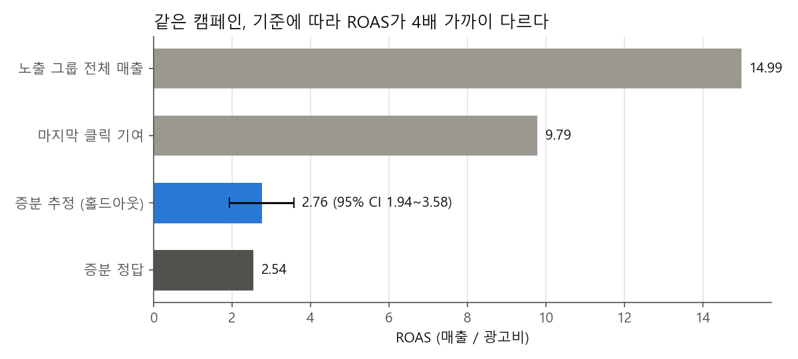
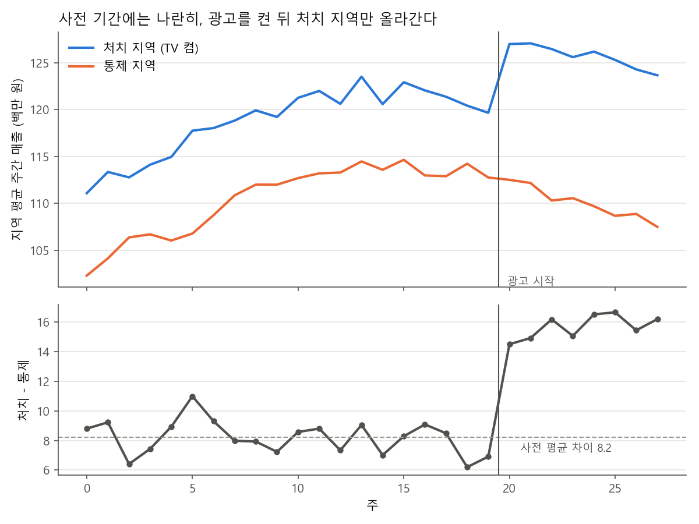
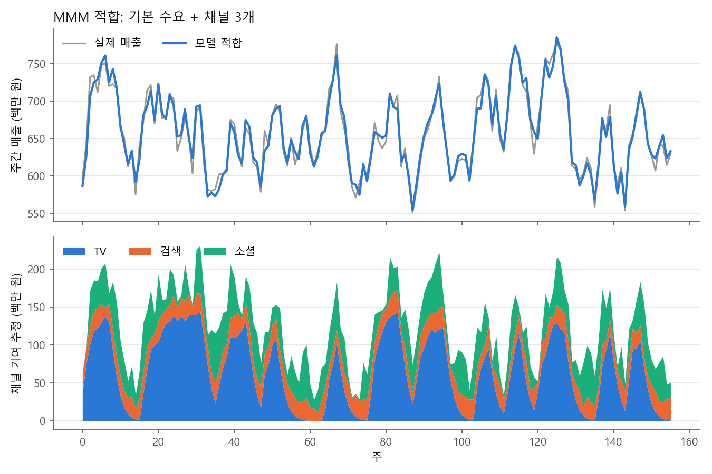
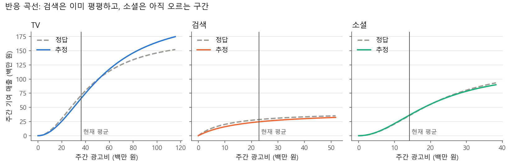
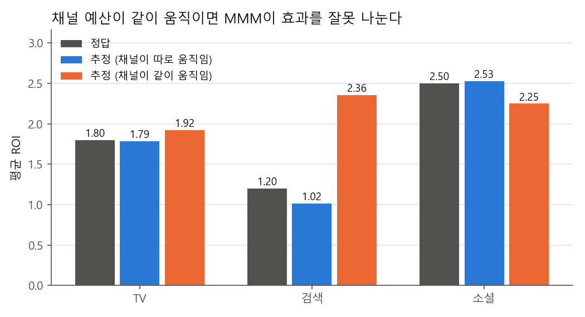

# 광고 증분 측정: 기여와 증분은 다른 질문이다

> 한 줄 요약: 광고비를 늘릴지 줄일지는 무엇으로 판단하나. 정답을 아는 합성 데이터에서 마지막 클릭 기여는 증분을 3.8배 부풀렸고, 홀드아웃, 지역 실험, MMM은 정답 근처를 되찾았다. 단 MMM은 채널 예산이 같이 움직이면 효과를 엉뚱한 채널에 나눠 준다.

## 질문

매체 리포트의 ROAS와 실험으로 잰 ROAS는 자주 몇 배씩 다르다. 기여(attribution)는 "일어난 전환을 채널에 어떻게 나눌까"에 답하고, 증분(incrementality)은 "광고가 없었다면 전환이 얼마나 줄었을까"에 답한다. 예산 판단에 필요한 것은 증분이다. 이 프로젝트는 증분을 재는 세 방법이 진짜 효과를 얼마나 되찾는지, 각각 얼마의 비용이 드는지를 한 세계 안에서 비교한다.

## 결론

- 같은 소셜 캠페인의 ROAS가 기준에 따라 다르다. 마지막 클릭 기여 9.79, 홀드아웃 증분 추정 2.76 (95% CI 1.94~3.58), 정답 2.54. 기여 매출은 증분 정답의 3.8배다.
- 유저 홀드아웃(20%)은 정답을 신뢰구간 안에 담았다. 대가는 홀드아웃 39,828명에게서 포기한 증분 매출 약 956만 원이다.
- 지역 실험(40개 지역, 사전 20주, 사후 8주)은 TV iROAS를 1.68 (95% CI 1.36~2.01)로 추정했다. 정답은 1.80. 사전 기간 처치-통제 차이의 기울기는 -0.059/주 (p=0.20)로 평행 추세 가정을 버릴 근거가 없었다.
- MMM(156주, 채널 3개)은 평균 ROI를 TV 1.79 (정답 1.80), 검색 1.02 (1.20), 소셜 2.53 (2.50)으로 추정했다. 검색 예산 30%를 소셜로 옮기면 주간 매출이 18.2백만 원 늘어난다고 예측했고, 정답 모델로는 19.4백만 원이다.
- 같은 정답에서 채널 예산을 같이 움직이게(상관 0.98~0.99) 만들면 MMM은 R2가 0.988로 더 높아졌는데도 검색 ROI를 2.36으로, 정답(1.20)의 2배로 추정했다. 적합도가 좋다고 채널 분리가 맞는 것은 아니다.

## 방법

### 한 세계의 정답

세 방법이 같은 세계를 재도록 채널별 진짜 평균 ROI(증분 매출 / 광고비)를 먼저 정했다.

| 채널 | 정답 ROI | 측정 방법 |
|---|---|---|
| TV | 1.8 | 지역 실험, MMM |
| 검색 | 1.2 | MMM |
| 소셜 (리타겟팅) | 2.5 | 유저 홀드아웃, 마지막 클릭 기여, MMM |

데이터는 모두 `run.py`가 시드를 고정해 만든 합성 데이터다 (`data/`). 실제 기업 데이터는 쓰지 않았다.

### 1. 유저 단위 홀드아웃 (`lift.py`)

- 유저 20만 명. 구매 의향은 유저마다 다르고(평균 구매율 4%), 광고는 구매 확률을 0.8%p 올린다
- 유저마다 광고가 없을 때 결과 `y0`와 있을 때 결과 `y1`을 둘 다 만든다. 그래서 진짜 증분 구매(`y1=1, y0=0`)를 셀 수 있다
- 무작위 20%를 홀드아웃으로 떼고 광고를 보내지 않는다
- 원래 살 사람도 60% 확률로 광고를 마지막에 클릭하고 산다. 이 구매도 매체 리포트에서는 광고 몫이 된다

```
증분 매출 = (노출 그룹 유저당 매출 - 홀드아웃 유저당 매출) x 노출 유저 수
iROAS     = 증분 매출 / 광고비
신뢰구간  = 유저당 매출 차이의 Welch 정규 근사 구간을 같은 식으로 키운다
```

### 2. 지역 실험과 이중차분 (`geo.py`)

- 40개 지역 x 28주 매출 패널. 지역 규모는 제각각이고, 계절 흐름은 모든 지역에 같은 크기로 들어간다
- 무작위로 고른 20개 지역에서 21주차부터 TV를 켠다. 광고비는 지역 규모의 4%, 증분은 광고비 x 1.8
- 지역, 주 고정효과 회귀로 효과를 추정하고 표준오차는 지역 단위로 묶는다

$$
\text{sales}_{rt} = \alpha_r + \gamma_t + \tau \cdot (\text{처치}_r \times \text{사후}_t) + \varepsilon_{rt}
$$

- 증분 매출 = tau x 처치 지역-주 칸 수, iROAS = 증분 매출 / 광고비
- 사전 추세 검정: 사전 기간의 주별 (처치 평균 - 통제 평균)을 주에 회귀해 기울기가 0과 다른지 본다

### 3. MMM (`mmm.py`)

주간 매출을 기본 수요와 채널 효과로 나눈다.

$$
\text{sales}_t = b_0 + b_1 \cdot \text{추세}_t + \sum_{h=1}^{2}\left(s_h \sin\frac{2\pi h t}{52} + c_h \cos\frac{2\pi h t}{52}\right) + \sum_{c} \beta_c \cdot S_c\left(A_{c,t}\right) + \varepsilon_t
$$

광고비는 두 변환을 거친다.

```
이월 (adstock):  A_t = x_t + lam x A_{t-1}
포화 (hill):     S(A) = A^s / (A^s + K^s)       K는 adstock 평균의 배수로 둔다
```

- 156주(3년). TV는 4주 단위로 켜고 끄는 플라이트, 검색과 소셜은 매주 무작위 금액
- 정답 변환 모수: TV (lam 0.65, K 1.2배, s 2), 검색 (0.1, 0.5배, 1), 소셜 (0.3, 1.6배, 2). 검색은 이미 포화된 채널로 설정했다
- `beta`는 채널별 평균 ROI가 정답 ROI가 되도록 맞췄다
- 추정: lam 10개 x K 7개 x s 3개 격자. 한 채널의 격자를 훑는 동안 다른 채널 값은 고정하고, 매 후보마다 나머지 계수는 최소제곱으로 푼다. 이를 채널마다 돌아가며 4바퀴 반복한다(좌표 하강). 채널 계수가 음수가 되는 후보는 버린다
- 채널 기여 = beta x S(A), 평균 ROI = 기여 합 / 광고비 합
- 반응 곡선: 매주 같은 금액 x를 계속 쓰는 정상 상태 (adstock = x / (1 - lam))
- 예산 재배분: 현재 평균 광고비에서 한계 ROI(1 더 쓸 때 늘어나는 매출)가 가장 낮은 채널의 예산 30%를 가장 높은 채널로 옮긴다
- 안정성: 광고비와 잡음 시드를 50번 바꿔 다시 추정하고 ROI의 5~95% 범위를 본다
- 채널이 같이 움직이는 경우: 같은 정답, 같은 모델에 세 채널 광고비가 한 예산 흐름을 따르는 데이터를 넣는다

## 결과

### 1. 기여가 증분을 과대평가하는 장면



| 기준 | ROAS | 매출(원) | 정답 대비 |
|---|---|---|---|
| 노출 그룹 전체 매출 (광고 몫으로 다 잡을 때) | 14.99 | 230,537,925 | 5.9배 |
| 마지막 클릭 기여 매출 (매체 리포트) | 9.79 | 150,500,587 | 3.8배 |
| 증분 매출 추정 (홀드아웃 비교) | 2.76 | 42,416,235 | 1.1배 |
| 증분 매출 정답 (합성 데이터) | 2.54 | 39,097,657 | 1.0배 |

- 구매율은 노출 4.84%, 홀드아웃 3.89%. 증분 0.95%p (95% CI 0.74~1.17), 설계값 0.8%p가 구간 안에 있다
- 마지막 클릭 기여 매출의 대부분은 광고가 없어도 일어났을 구매다. 기여 모델을 라스트터치에서 멀티터치로 바꿔도 이 부분은 빠지지 않는다
- 정답 2.54는 이번 표본에서 실제로 생긴 증분이고, 설계값 2.5와 표본 잡음만큼 다르다

### 2. 지역 실험



- 사전 20주 동안 처치-통제 차이는 평균 8.2 근처에서 오르내리고, 광고를 켠 21주차부터 한 단계 올라간다
- 지역-주당 증분 추정 7.48 (95% CI 6.05~8.91), 정답 평균 8.00. 증분 매출 1,197 (정답 1,279) 백만 원, 광고비 711 백만 원
- 구간 폭(iROAS 1.36~2.01)이 홀드아웃보다 좁은 것은 광고비가 지역 매출의 4%로 커서다. 지역 수가 적거나 효과가 작으면 구간은 금방 넓어진다

### 3. MMM





| 채널 | 정답 ROI | 추정 ROI | 시드 50개 5~95% | 같이 움직일 때 추정 ROI | 한계 ROI 추정 | 한계 ROI 정답 |
|---|---|---|---|---|---|---|
| TV | 1.8 | 1.79 | 1.60~2.01 | 1.92 | 2.5 | 2.3 |
| 검색 | 1.2 | 1.02 | 0.26~2.48 | 2.36 | 0.45 | 0.4 |
| 소셜 | 2.5 | 2.53 | 2.19~3.58 | 2.25 | 3.51 | 3.58 |

- R2 0.963. TV 이월률은 0.7 (정답 0.65), 소셜은 0.3 (정답 0.3)으로 찾았다
- 검색은 평균 ROI 1.2인데 한계 ROI는 0.4다. 이미 포화돼서 더 써도 1원당 0.4원만 돌아온다. 평균 ROI만 보면 이 차이가 안 보인다
- 검색 추정치가 시드에 따라 0.26~2.48로 크게 흔들린다. 포화된 채널은 광고비가 바뀌어도 매출이 거의 안 바뀌어서 기본 수요(상수항)와 구분하기 어렵다

| 옮긴 채널 | 받은 채널 | 옮긴 금액(백만 원/주) | 주간 매출 변화 추정 | 주간 매출 변화 정답 |
|---|---|---|---|---|
| 검색 | 소셜 | 6.9 | 18.2 | 19.4 |



- 세 채널 예산이 같은 흐름으로 늘고 줄면 모델은 총 효과는 맞히지만 채널별로 나누는 근거가 없다. 검색 ROI를 2배로 잡고 소셜을 깎았다
- 이 데이터로 검색 예산을 늘리면 손해를 본다. 데이터 안에서는 이 오류를 발견할 방법이 없다

### 결론 표: 방법별 추정치 vs 정답

| 방법 | 채널 | 추정 ROI (괄호: 구간) | 정답 | 비용 | 언제 쓰나 |
|---|---|---|---|---|---|
| 마지막 클릭 기여 | 소셜 | 9.79 | 2.54 | 거의 없음 (매일 나옴) | 소재, 입찰 같은 일상 운영의 상대 비교 |
| 유저 홀드아웃 | 소셜 | 2.76 (1.94~3.58) | 2.54 | 홀드아웃 39,828명의 증분 매출 약 956만 원 포기 | 유저 단위로 노출을 막을 수 있는 채널의 예산 판단 |
| 지역 실험 (DID) | TV | 1.68 (1.36~2.01) | 1.80 | 통제 지역 x 주 160칸 광고 중단, 지역 수가 적으면 구간이 넓다 | TV, 옥외처럼 사람 단위로 못 막는 채널 |
| MMM | TV | 1.79 (시드 50개 5~95%: 1.60~2.01) | 1.80 | 주간 데이터 2~3년, 실험 비용 없음 | 채널 전체 예산 배분, 실험으로 보정한 뒤 |
| MMM | 검색 | 1.02 (시드 50개 5~95%: 0.26~2.48) | 1.20 | 주간 데이터 2~3년, 실험 비용 없음 | 채널 전체 예산 배분, 실험으로 보정한 뒤 |
| MMM | 소셜 | 2.53 (시드 50개 5~95%: 2.19~3.58) | 2.50 | 주간 데이터 2~3년, 실험 비용 없음 | 채널 전체 예산 배분, 실험으로 보정한 뒤 |
| MMM (채널이 같이 움직임) | TV | 1.92 | 1.80 | 같음 | 이 상태로는 채널 분리에 쓰지 않는다 |
| MMM (채널이 같이 움직임) | 검색 | 2.36 | 1.20 | 같음 | 이 상태로는 채널 분리에 쓰지 않는다 |
| MMM (채널이 같이 움직임) | 소셜 | 2.25 | 2.50 | 같음 | 이 상태로는 채널 분리에 쓰지 않는다 |

실무에서는 셋을 겹쳐 쓴다. MMM으로 채널 예산을 크게 나누고, 홀드아웃과 지역 실험으로 MMM의 채널별 추정을 확인하고, 기여 모델로 매일의 운영을 조정한다.

## 한계와 다음 단계

- **MMM은 실험 결과로 보정해야 한다.** MMM은 회귀라서 인과를 보장하지 않는다. 이 프로젝트에서도 검색 ROI는 시드에 따라 0.26~2.48로 흔들렸다. 홀드아웃이나 지역 실험으로 얻은 채널 iROAS를 사전 정보나 제약으로 넣어 MMM을 맞추는 것이 정석이다. 여기서는 보정 단계를 구현하지 않았다
- **채널이 같이 움직이면 분리가 어렵다.** 예산이 한 흐름으로 늘고 줄면 R2가 높아도 채널별 효과는 엉뚱하게 나뉜다. 데이터를 더 모으는 것보다 일부러 채널 예산을 따로 흔드는 기간(실험)을 만드는 편이 낫다
- 정답 세계가 모델과 같은 모양(adstock + hill)이라 MMM에 유리하다. 실제 매출은 가격, 프로모션, 경쟁사, 휴일 같은 변수가 빠져 있으면 그 몫이 광고 효과로 새어 들어간다
- 홀드아웃은 광고 효과가 모든 유저에게 같다고(0.8%p) 두었다. 실제로는 의향이 높은 유저에게 효과가 작은 경우가 많아서 타겟팅 정책에 따라 iROAS가 달라진다
- 지역 실험은 지역 사이 이동(통제 지역 유저가 처치 지역 광고를 보는 경우)과 지역별 다른 추세를 넣지 않았다. 지역 수가 적으면 합성 통제(synthetic control)를 함께 쓴다
- MMM 추정에 신뢰구간 대신 시드 반복 범위를 썼다. 베이지안 MMM(Meridian, PyMC-Marketing)은 사후분포로 불확실성을 직접 준다

## 실행

```
pip install -r ../../requirements.txt
python run.py
python -m pytest tests
```

`run.py`는 `data/`의 합성 데이터와 `outputs/`의 그림, 표를 모두 다시 만든다 (약 15초).

## 더 읽을 것

- Gordon, Zettelmeyer, Bhargava, Chapsky (2019). A Comparison of Approaches to Advertising Measurement: Evidence from Big Field Experiments at Facebook. Marketing Science. https://pubsonline.informs.org/doi/10.1287/mksc.2018.1135
- Vaver, Koehler (2011). Measuring Ad Effectiveness Using Geo Experiments. Google Research. https://research.google/pubs/measuring-ad-effectiveness-using-geo-experiments/
- Jin, Wang, Sun, Chan, Koehler (2017). Bayesian Methods for Media Mix Modeling with Carryover and Shape Effects. Google Research. https://research.google/pubs/bayesian-methods-for-media-mix-modeling-with-carryover-and-shape-effects/
- Robyn (Meta, R): https://facebookexperimental.github.io/Robyn/
- Meridian (Google, Python): https://github.com/google/meridian
- PyMC-Marketing: https://www.pymc-marketing.io/
