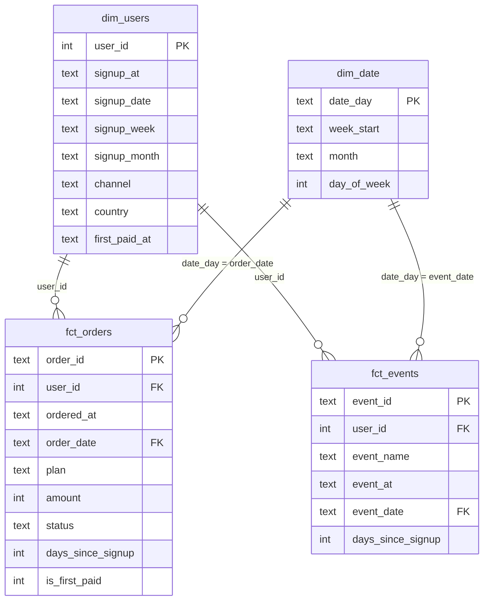
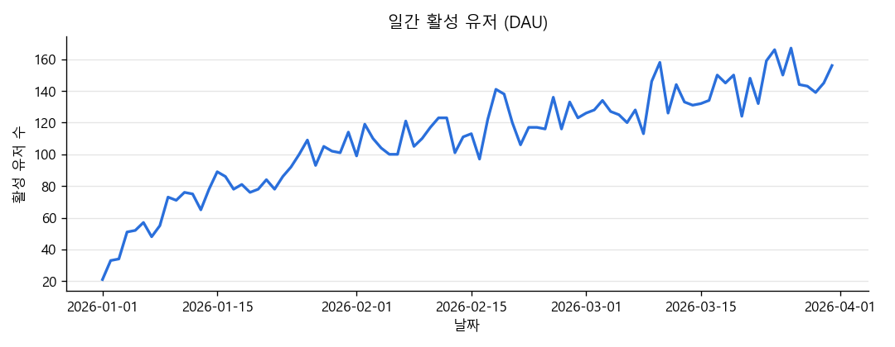
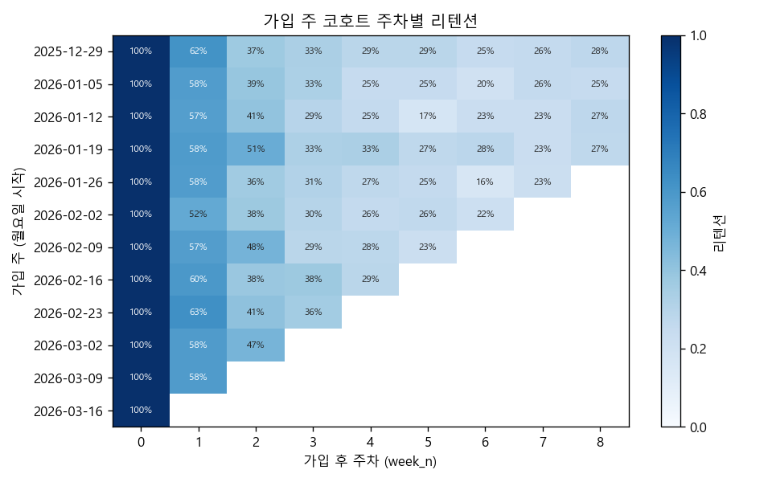

# 원본 로그에서 지표 마트까지: SQL 레이어와 데이터 테스트

같은 지표인데 대시보드마다, 뽑는 사람마다 숫자가 조금씩 다르게 나오는 일을 자주 겪었습니다. 쿼리를 잘 짜고 못 짜고의 문제라기보다 구조의 문제가 아닐까 궁금해서, dbt 스타일 레이어를 sqlite3와 SQL 파일만으로 직접 쌓아 봤습니다.

## 왜 공부했나

숫자가 어긋나는 원인을 따라가 보면 대개 비슷한 곳에서 갈립니다. 중복 적재를 누가 어디서 거르는지, 행 하나가 무엇인지(grain), 분모가 누구인지가 쿼리마다 다릅니다. 그래서 정제 규칙과 지표 정의를 한 곳에 모아 두고, 데이터 테스트로 확인하면 정말 같은 숫자가 나오는지 확인해 보고 싶었습니다.

## 결과

원본 이벤트 31,281행 중 익명 596행과 재전송 중복 870행을 staging에서 걸러 29,815행이 남았습니다. 결제 1,007행은 환불 상태 갱신 40건을 최신 상태로 합치니 967건이 됐습니다.

데이터 테스트는 17개(키 유일성 4, not null 4, 참조 무결성 3, 조인 전후 행 수 3, 지표 합계 대조 3)를 만들었고 모두 통과했습니다. 일부러 깨뜨린 데이터(중복 키, NULL, 고아 행, fan-out, 지표 누락)를 넣으면 해당 테스트가 실패하는 것도 확인했습니다.

지표 값은 다음과 같이 나왔습니다.

- 가입 후 14일 결제 전환율은 1월 24.6%, 2월 27.4%, 3월 26.3%입니다 (14일 창을 다 본 가입자만 분모에 넣었습니다).
- ARPPU는 1월 31,654원, 2월 24,750원, 3월 19,940원입니다. 연간권(99,000원)이 첫 결제 월에 몰려서 초기 ARPPU가 높게 나온 것으로 보입니다.
- 주차별 리텐션(코호트 합산)은 1주차 58.2%, 2주차 41.6%, 4주차 27.7%입니다.

## 어떻게 했나

### 레이어와 실행 순서

```
data/raw_*.csv  ->  sql/01_staging/stg_*  ->  sql/02_marts/dim_*, fct_*  ->  sql/03_metrics/metric_*
```

`run.py`를 실행하면 합성 원본을 만들어 sqlite 메모리 DB에 TEXT로 적재하고, `sql/` 아래 파일을 레이어 순서대로 실행한 다음 데이터 테스트를 돌립니다. SQL 파일 맨 위에는 모델 이름과 grain을 한 줄로 적어 두었습니다. 나중에 다시 열어 봤을 때 이 테이블의 한 행이 뭔지 바로 알 수 있어서 편했습니다.

```sql
-- fct_orders | grain: order_id 1행 = 결제 시도 1건 (실패, 환불 포함, status로 구분)
```

레이어는 접두사로 구분했습니다.

| 접두사 | 레이어 | 하는 일 |
|---|---|---|
| `stg_` | staging | 원본 1개당 1개. 타입 변환, 공백과 대소문자 정리, 중복 제거만 한다. 비즈니스 로직 없음 |
| `dim_` | marts | 누구, 언제를 설명하는 속성 테이블 (dim_users, dim_date) |
| `fct_` | marts | 일어난 일 1건 = 1행 (fct_orders, fct_events) |
| `metric_` | metrics | 지표 정의서의 정의를 그대로 옮긴 집계 테이블 |

### 원본에 일부러 심어 둔 문제와 staging에서 처리한 방법

실무 로그에서 자주 보던 지저분함을 합성 원본에 일부러 넣고, staging에서 하나씩 정리했습니다.

| 원본 문제 | 처리 |
|---|---|
| 같은 유저, 결제, 이벤트가 두 번 적재됨 | `ROW_NUMBER() OVER (PARTITION BY 키 ORDER BY ingested_at)`로 1행만 남김 |
| 결제가 paid로 들어온 뒤 같은 id가 refunded로 다시 들어옴 | 가장 늦게 적재된 행을 채택 (`ingested_at DESC`) |
| 이벤트 재전송 | 가장 먼저 도착한 행을 채택 (`ingested_at ASC`) |
| 시각 형식 혼재 (`2026-01-05T10:00:00Z`, `2026-01-05 10:00:00`) | `T`, `Z`를 바꾼 뒤 `datetime()` |
| 금액이 문자열, 일부는 `9,900` | 쉼표 제거 후 `CAST(... AS INTEGER)` |
| 채널, 상태값의 대소문자와 공백 | `lower(trim())` |
| 로그인 전 익명 이벤트 (`user_id` NULL) | stg_events에서 제외. 유저 단위 지표의 분모가 아니기 때문 |

결제와 이벤트의 중복 처리 방향이 반대인 점이 처음에 헷갈렸습니다. 결제는 상태가 바뀌니 마지막 행이 맞고, 이벤트는 같은 일이 다시 전송된 것이니 처음 행이 맞습니다.

### 스타 스키마 (ERD)



fct 두 개는 dim_users에 LEFT JOIN으로 붙입니다. dim_users의 키가 유일하지 않으면 이 조인에서 행이 불어나기 때문에(fan-out), 유일성 테스트와 행 수 보존 테스트를 짝으로 두었습니다.

### 데이터 테스트

테스트 함수는 `src/metric_mart_sql/checks.py`에 있습니다. 함수마다 위반 건수를 돌려주게 했고, 0이면 통과로 봤습니다.

| 종류 | 대상 | 잡는 문제 |
|---|---|---|
| unique | dim_users.user_id, dim_date.date_day, fct_orders.order_id, fct_events.event_id | 중복 제거 누락, 재적재 |
| not_null | dim_users.signup_date, fct_orders.user_id, fct_orders.amount, fct_events.user_id | 형식 변환 실패가 NULL로 숨는 경우 |
| relationships | fct_orders, fct_events -> dim_users / fct_events -> dim_date | 고아 행, 날짜 스파인 구멍 |
| row_count | stg_users = dim_users, stg_payments = fct_orders, stg_events = fct_events | 조인 fan-out, INNER JOIN으로 인한 누락 |
| sums_match | metric_arppu 매출 = fct_orders(paid) 합계, DAU 합 = (유저, 날짜) 쌍 수, new_users 합 = 가입자 수 | 지표 레이어에서 행이 빠지거나 불어남 |

`tests/test_checks.py`에서는 깨끗한 데이터에서 17개가 모두 통과하는지와, 데이터를 하나씩 일부러 깨뜨렸을 때 해당 테스트가 실패하는지를 함께 확인했습니다. 예를 들어 dim_users에 중복 키를 넣고 fct_orders만 다시 만들면, 그 유저의 결제 건수만큼 행이 불어나고 행 수 보존 테스트가 정확히 그 차이를 보고했습니다.

## 숫자로 본 결과

### 레이어별 행 수

| 테이블 | 행 수 |
|---|---:|
| raw_users | 2,040 |
| raw_payments | 1,007 |
| raw_events | 31,281 |
| stg_users | 2,000 |
| stg_payments | 967 |
| stg_events | 29,815 |
| dim_users | 2,000 |
| dim_date | 90 |
| fct_orders | 967 |
| fct_events | 29,815 |

stg와 fct의 행 수가 같다면 조인에서 행이 불어나거나 빠지지 않았다고 볼 수 있습니다. 최종 결제 상태는 paid 886, failed 41, refunded 40건이었습니다.

### 지표 정의서

지표마다 분자, 분모, grain을 따로 적어 두니 나중에 숫자가 이상할 때 어디부터 볼지가 분명해졌습니다.

| 지표명 | 정의 | 분자 | 분모 | grain | 주의점 |
|---|---|---|---|---|---|
| DAU (`metric_daily_active.dau`) | 그날 이벤트를 1건 이상 남긴 로그인 유저 수 | 그날 이벤트가 있는 고유 user_id 수 | 없음 (건수 지표) | date_day 1행 | 익명 이벤트 제외. 날짜 스파인(dim_date)에 붙여 0인 날도 남긴다. 일별 DAU를 더한 값은 고유 유저 수가 아니다 |
| 14일 결제 전환율 (`metric_payment_conversion`) | 가입 후 14일 안(가입일 포함 0~13일차)에 첫 결제를 완료한 가입자 비율 | 첫 paid 결제가 0~13일차인 가입자 수 | 가입일이 데이터 끝에서 13일 이전인 가입자 수 | signup_month 1행 | 14일 창을 다 보지 못한 최근 가입자를 분모에서 빼야 전환율이 낮게 찍히지 않는다. 실패, 환불 결제는 전환으로 세지 않는다 |
| 주차별 리텐션 (`metric_retention_cohort`) | 가입 주 코호트 중 가입 후 n주차(7n ~ 7n+6일차)에 이벤트를 남긴 비율 | n주차에 이벤트가 있는 코호트 유저 수 | 코호트 가입자 수 | (signup_week, week_n) 1행 | 달력 주가 아니라 가입일 기준 상대 주차. 코호트 마지막 가입자의 n주차가 끝나지 않은 칸은 넣지 않는다. 그 주에 아무도 오지 않은 칸은 행이 없다 (0으로 해석) |
| ARPPU (`metric_arppu`) | 결제 월의 결제 유저 1인당 매출 | 그달 paid 결제 금액 합계 | 그달 paid 결제가 있는 고유 유저 수 | month 1행 | 환불, 실패 제외. 연간권이 결제 월에 한꺼번에 잡혀 월별 비교가 흔들린다. 매출을 월 단위로 나누어 인식하려면 별도 모델이 필요하다 |

### 지표 값

| 가입 월 | 분모 가입자 | 14일 내 전환 | 전환율 |
|---|---:|---:|---:|
| 2026-01 | 687 | 169 | 24.6% |
| 2026-02 | 614 | 168 | 27.4% |
| 2026-03 | 399 | 105 | 26.3% |

3월 가입자 중 분모에 들어간 사람은 3월 18일까지 가입한 사람뿐입니다.

| 결제 월 | 매출(원) | 결제 유저 | 결제 건 | ARPPU(원) |
|---|---:|---:|---:|---:|
| 2026-01 | 4,811,400 | 152 | 153 | 31,654 |
| 2026-02 | 7,425,000 | 300 | 300 | 24,750 |
| 2026-03 | 8,474,400 | 425 | 433 | 19,940 |

DAU는 평균 110.0명, 최대 167명이었습니다. 가입자가 계속 들어오는 구조라 기간 내내 우상향합니다.





| 주차 | 0 | 1 | 2 | 3 | 4 | 5 | 6 | 7 | 8 |
|---|---:|---:|---:|---:|---:|---:|---:|---:|---:|
| 리텐션 (코호트 합산) | 100% | 58.2% | 41.6% | 32.3% | 27.7% | 24.3% | 22.0% | 23.7% | 26.7% |

7, 8주차에서 리텐션이 다시 오르는 걸 보고 처음엔 이상하다고 생각했습니다. 확인해 보니 이탈이 줄어서가 아니라, 그 칸을 관측한 코호트가 1월 초 몇 개뿐이라 구성이 바뀐 탓으로 보입니다. 주차끼리 비교하려면 같은 코호트 집합으로 맞춰야 한다는 걸 배웠습니다.

## 아쉬운 점과 다음에 해 볼 것

- 합성 데이터라 지표 값 자체에는 의미가 없습니다. 이번에 확인하고 싶었던 건 레이어 구조와 테스트로 숫자를 지키는 방식이었습니다.
- 모든 모델을 매번 통째로 다시 만들었습니다. 실제 규모라면 증분 적재(새로 들어온 날짜만 처리)와 늦게 도착한 데이터 처리 규칙이 필요할 것 같습니다.
- 시간대(UTC와 현지 시각) 변환은 다루지 않았습니다. 일 단위 지표라면 날짜 경계를 어느 시간대 기준으로 자르는지 정의서에 적어야 합니다.
- 이번 테스트는 구조를 보는 테스트라서 "전환율이 갑자기 절반이 되었다" 같은 분포 이상은 잡지 못합니다. 다음에는 전일 대비 변화량 경고를 붙여 볼 생각입니다.
- dbt를 쓰면 `ref()`로 의존 순서를 자동으로 잡고 테스트도 yml에 선언할 수 있습니다. 여기서는 순서를 파일 이름과 `MART_ORDER`로 직접 정했습니다.

## 직접 돌려 보기

```
pip install -r ../../requirements.txt
python run.py
python -m pytest tests
```

`run.py`를 돌리면 `data/`에 원본 CSV 3개가, `outputs/`에 지표 CSV, 데이터 테스트 결과, 그림 2개가 생깁니다. 시드는 42, 가입자는 2,000명입니다.

## 참고한 자료

- dbt Labs, How we structure our dbt projects: https://docs.getdbt.com/best-practices/how-we-structure/1-guide-overview
- dbt Labs, Data tests: https://docs.getdbt.com/docs/build/data-tests
- Ralph Kimball, Margy Ross, The Data Warehouse Toolkit, 3rd ed. (Wiley, 2013). 4장 grain 선언
- SQLite, Window Functions: https://www.sqlite.org/windowfunctions.html
