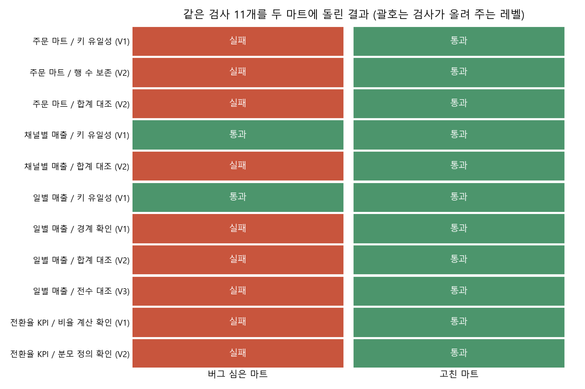

# "검증했다"를 등급으로 나누는 검사 키트

분석 결과를 공유하면서 "검증했어요"라고 말할 때, 내가 어디까지 확인한 건지 스스로도 애매할 때가 많았습니다. 쿼리가 돌아간 것과 외부 숫자와 전부 맞춰 본 것은 분명 다른데 같은 말로 묶여 버리는 게 마음에 걸려서, 검증을 단계(V0~V3)로 나눠 보고 각 단계가 어떤 버그를 잡는지 직접 돌려 봤습니다.

## 왜 공부했나

"검증했다"의 범위는 사람마다 다릅니다. 쿼리가 돌아간 것, 내가 만든 숫자끼리 맞춘 것, 외부 기준과 전부 맞춘 것이 같은 단어로 묶이면 듣는 사람은 확인 범위를 실제보다 넓게 받아들이기 쉽습니다.

그래서 실무에서 자주 나는 마트 버그 다섯 가지를 일부러 심어 두고, 어떤 검사가 각 버그를 잡는지, 그 검사가 검증 레벨 중 어디에 해당하는지를 확인해 봤습니다. 버그를 심은 마트와 고친 마트에 같은 검사 11개를 돌렸습니다.

## 결과

먼저 놀랐던 건 버그 마트도 빌드는 에러 없이 끝난다는 점입니다. "쿼리가 돌아갔다"(V0)만으로는 아무것도 걸러지지 않았습니다. 버그 마트는 9개 검사에서 걸려 V0에 머물렀고, 고친 마트는 전부 통과해 문서 레벨 V2(일별 매출만 V3)를 받았습니다.

버그별로 보면 이렇습니다.

- 조인 fan-out 때문에 주문 마트가 1,111행에서 2,192행으로 늘었고, 금액 합은 67,492,000에서 134,037,000으로 1.99배가 됐습니다. 키 유일성, 행 수 보존, 합계 대조 세 검사가 모두 잡았습니다.
- 채널 NULL 누락으로 9월 채널별 매출 합이 3,574,000(7.2%) 모자랐고, 기간 경계 오류로 9/30 하루치 1,567,000(3.2%)이 빠졌습니다. 이 두 버그는 키 유일성으로는 못 잡고, 합계 대조, 경계 확인, 전수 대조로만 잡혔습니다.
- 전환율은 정수 나눗셈 때문에 0이 됐습니다. 분모도 전체 가입자 2,000명으로 잡혀 정의상 모집단 1,822명과 어긋났습니다. 실수 나눗셈으로 고쳐도 31.60%로, 맞는 값 34.69%보다 3.1%p 낮게 나옵니다.
- 같은 검사 11개에서 버그 마트는 2개, 고친 마트는 11개를 통과했습니다. 고친 마트도 문서 레벨은 가장 낮은 마트를 따라 V2로 매기고, 확인하지 못한 범위는 검증 카드에 따로 적었습니다.

## 어떻게 했나

### 합성 원천 테이블

`src/analysis_validation_kit/data.py`에서 시드 20261020으로 sqlite3에 만들었습니다.

- `users` 2,000명: 테스트 계정 약 3%, 유입 채널 NULL 약 8%
- `events` 방문 로그: 한 유저가 하루 1~3회 방문 (fan-out 재료)
- `orders`: 방문한 날에만 주문이 생기고, 주문 시각은 하루 중 아무 때나
- `channels`: 채널 이름 룩업 (NULL 채널은 없음)
- `ref_daily`: 외부 기준 역할. SQL 마트와 따로 파이썬으로 원천 행을 세어 만든 9월 일별 주문 수와 매출

### 마트 네 개를 두 버전으로

`marts.py`에 집계 기간 2026년 9월 기준으로 마트를 만들었습니다. 버그 하나가 어느 검사에 걸리는지 분명하게 보고 싶어서 마트마다 버그를 나눠 심었습니다.

| 마트 | 심은 버그 | 버그 쿼리 | 고친 쿼리 |
|---|---|---|---|
| 주문 마트 | 조인 fan-out으로 매출 중복 | 같은 날 방문 로그와 `JOIN` | `EXISTS`로 방문 여부만 표시 |
| 채널별 매출 | NULL 누락 | 채널 룩업과 `INNER JOIN` | `COALESCE(channel, '미분류')` |
| 일별 매출 | 기간 경계(포함/미포함) | `order_ts BETWEEN '2026-09-01' AND '2026-09-30'` | `>= '2026-09-01' AND < '2026-10-01'` |
| 전환율 KPI | 분모 모집단 불일치 | 분모 = 전체 가입자 수 | 분모 = 9월 방문한 비테스트 유저 수 |
| 전환율 KPI | 정수 나눗셈 | `buyers / visitors` | `1.0 * buyers / visitors` |

기간 경계 버그는 한 번 짚고 넘어갈 만합니다. 타임스탬프가 문자열 `'2026-09-30 14:00:00'`이면 `'2026-09-30'`보다 커서 `BETWEEN`의 끝에서 빠집니다. 그래서 9/30은 00:00 이후 주문이 전부 사라집니다.

### 검사 함수

`checks.py`의 검사는 모두 `{table, check, level, passed, detail}`을 돌려주게 만들었습니다.

| 검사 | 확인하는 것 | 비교 대상 |
|---|---|---|
| 행 수 보존 | 마트 행 수 = 원천 행 수 | 원천 `orders` |
| 키 유일성 | 키 조합 중복 0개 | 마트 자신 |
| 합계 대조 | 마트 합계 = 기준 합계 | 원천 `orders`, 외부 기준 `ref_daily` |
| 분모 정의 확인 | 마트 분모 = 지표 정의서의 모집단 수, 분자 <= 분모 | 원천 `events`, `users` |
| 비율 계산 확인 | 저장된 비율 = 같은 행의 분자 / 분모 (실수) | 마트 자신 |
| 경계 확인 | 날짜가 9/1~9/30을 빠짐없이, 넘치지 않게 덮음 | 기대 달력 |
| 전수 대조 | 모든 날짜, 모든 컬럼이 셀 단위로 같음 | 외부 기준 `ref_daily` |

### 레벨 매기기

`suite.py`에서 레벨을 매겼습니다. 빌드가 돌면 V0에서 시작하고, V1 검사가 전부 통과하면 V1, V2 검사까지 전부 통과하면 V2, V3 검사까지 통과하면 V3을 줍니다. 문서 전체 레벨은 가장 낮은 마트를 따르게 했습니다.

## 검사 결과 자세히



### 원고의 검증 레벨과 이 키트 검사의 대응

| 레벨 | 원고의 정의 | 이 키트에서 해당하는 것 | 잡는 버그 |
|---|---|---|---|
| V0 미검증 | 쿼리가 돌아갔다 | `build_marts`가 에러 없이 끝남 | 없음 (버그 마트도 통과) |
| V1 자기 일관성 | 자동 검사(합계, 키 유일성 등) 통과 | 키 유일성, 비율 계산 확인, 경계 확인 | fan-out(키 중복), 정수 나눗셈, 기간 경계 |
| V2 외부 부분 대조 | 내가 만들지 않은 기준과 일부 기간이나 일부 컬럼을 맞춤 | 행 수 보존, 합계 대조, 분모 정의 확인 (원천 로그, 외부 기준과 합계 한 숫자씩) | fan-out(행 수, 금액), NULL 누락, 기간 경계, 분모 모집단 불일치 |
| V3 외부 전수 대조 | 외부 기준과 전 기간, 전 컬럼을 셀 단위로 맞춤 | 전수 대조 (일별 매출 30일 x 2컬럼 = 60셀) | 기간 경계 (9/30 행 불일치) |

원고에 정리한 자동 검사 패턴 6가지 중 합계 등식(합계 대조), 키 유일성, 분모 NULL/0(비율 계산 확인에서 분모가 0이나 NULL이면 실패), 기간 누락(경계 확인)은 위 검사에 넣었습니다. 퍼널 단조성과 0행 적재는 이번 데모의 버그와 맞지 않아서 다루지 않았습니다.

### 버그별로 어느 검사가 잡았나

`outputs/check_results.csv`에 저장된 결과입니다.

| 마트 / 검사 (레벨) | 버그 마트 | 고친 마트 |
|---|---|---|
| 주문 마트 / 키 유일성 (V1) | 실패: 중복 키 718개 | 통과 |
| 주문 마트 / 행 수 보존 (V2) | 실패: 2,192행 / 원천 1,111행 | 통과 |
| 주문 마트 / 합계 대조 (V2) | 실패: 134,037,000 / 67,492,000 | 통과 |
| 채널별 매출 / 키 유일성 (V1) | 통과 | 통과 |
| 채널별 매출 / 합계 대조 (V2) | 실패: 45,826,000 / 49,400,000 | 통과 |
| 일별 매출 / 키 유일성 (V1) | 통과 | 통과 |
| 일별 매출 / 경계 확인 (V1) | 실패: 9/1~9/29, 29일 | 통과 |
| 일별 매출 / 합계 대조 (V2) | 실패: 47,833,000 / 49,400,000 | 통과 |
| 일별 매출 / 전수 대조 (V3) | 실패: 9/30 불일치 | 통과 |
| 전환율 KPI / 비율 계산 확인 (V1) | 실패: 저장값 0 / 0.3160 | 통과 |
| 전환율 KPI / 분모 정의 확인 (V2) | 실패: 분모 2,000 / 정의상 1,822 | 통과 |

이 표에서 제가 눈여겨본 건 두 가지입니다.

첫째, 키 유일성 검사는 NULL 누락과 기간 경계 버그를 잡지 못했습니다. 행이 빠지는 버그는 남은 행끼리는 멀쩡하기 때문입니다. 마트 안만 보는 V1 검사로는 "없는 행"을 알 수 없고, 원천이나 외부 기준과 맞춰 봐야(V2) 드러났습니다.

둘째, 버그 마트의 레벨은 V0였습니다(채널별 매출만 V1). 빌드가 성공했다는 이유로 "검증했다"고 말했다면 이 마트가 그대로 공유됐을 겁니다.

### 고친 마트의 검증 카드

`run.py`를 돌리면 `outputs/validation_card.md`에 아래 카드가 생성됩니다.

```
[검증 카드]  레벨: V2   대상: 고친 마트 4개

- 마트별 레벨 : 주문 마트 V2, 채널별 매출 V2, 일별 매출 V3, 전환율 KPI V2
- 문서 레벨   : 가장 낮은 마트를 따라 V2
- 대조 기준   : 원천 orders, events, users 테이블 / 외부 기준 ref_daily (9월 일별 주문 수, 매출)
- 결과        : 검사 11개 중 11개 통과
- 미검증      : 채널별 매출과 전환율은 합계, 분모 한 숫자만 외부와 맞춤(채널 단위 셀 대조 안 함). 9월 이외 기간. 지표 정의 자체가 맞는지는 검사 범위 밖
- 재현 방법   : python run.py
- 검증자      : 자동 검사
```

일별 매출은 V3이지만 다른 마트가 V2라서 문서 전체는 V2로 매겼습니다. 원고에 적은 "체인의 강도는 가장 약한 고리로 정해진다"를 그대로 따랐습니다.

## 아쉬운 점과 다음에 해 볼 것

- 검사를 전부 통과했다고 정의까지 맞다는 뜻은 아닙니다. 분모 정의 확인은 "정의서와 같은가"만 봅니다. 정의서가 분모를 처음부터 잘못 잡았다면(예: 방문자가 아니라 가입자) 검사는 그대로 통과합니다.
- 이번 데모의 외부 기준 `ref_daily`는 같은 원천을 파이썬으로 따로 센 것입니다. 실무라면 운영 대시보드 원본, 다른 팀 산출물, 재무 확정치처럼 정말로 내가 만들지 않은 기준이어야 V2, V3로 인정할 수 있다고 생각합니다. 내가 만든 재현 쿼리와 맞춘 것은 최대 V1로 봐야 합니다.
- 버그를 마트마다 하나씩 나눠 심었습니다. 실무에서는 버그가 겹쳐 서로 상쇄될 수도 있습니다(예: fan-out으로 늘고 경계 오류로 줄어 합계가 우연히 맞음). 그래서 합계 하나보다는 행 수, 키, 셀 단위 대조를 함께 돌리는 편이 안전해 보입니다.
- 검사는 원천 테이블이 아니라 실제로 소비하는 마트에 돌렸습니다. 원천에 돌리면 테스트 계정처럼 원래 걸러질 행 때문에 과탐이 납니다.
- 다음에는 퍼널 단조성과 0행 적재 검사를 추가하고, 채널 단위 셀 대조로 채널별 매출을 V3로 올려 보고 싶습니다. 검사 결과를 실행마다 기록해서 "불일치를 몇 번 찾았나" 이력을 남기는 것도 해 볼 생각입니다.

## 직접 돌려 보기

```
pip install -r ../../requirements.txt
python run.py
python -m pytest tests
```

run.py를 돌리면 `data/mart_buggy.sqlite`, `data/mart_fixed.sqlite`(원천 테이블 + 마트)와 `outputs/` 아래 그림 1개, 결과 표, 검증 카드가 만들어집니다(약 8초). tests에서는 작은 표본(유저 400명)으로 "버그 마트는 해당 검사 실패, 고친 마트는 전부 통과"인지와 검사 함수별 알려진 정답을 확인했습니다.

## 참고한 자료

- dbt 문서, Data tests (unique, not_null, relationships): https://docs.getdbt.com/docs/build/data-tests
- Great Expectations 문서, Expectations 개요: https://docs.greatexpectations.io/
- SQLite 문서, Datatypes (정수 나눗셈과 타입 친화성): https://www.sqlite.org/datatype3.html
- Kleppmann, M. (2017). *Designing Data-Intensive Applications*. O'Reilly.
