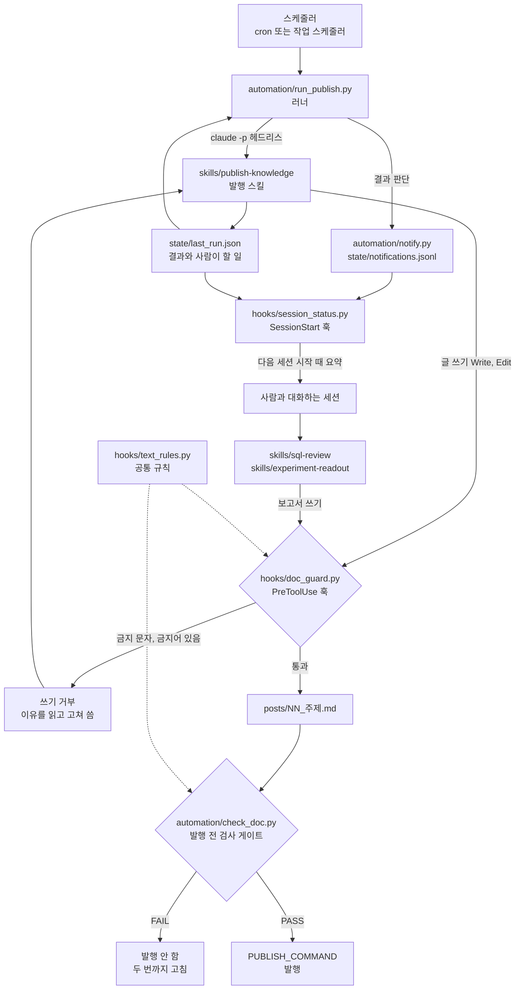

# 분석가의 Claude Code 작업 방식

> 한 줄 요약: 데이터 분석가가 반복하는 일(SQL 리뷰, 실험 결과 보고서, 지식 글 발행)을 Claude Code 스킬로 만들고, 지켜야 할 규칙은 훅과 검사 스크립트로 강제한 구성 예시다.

## 무엇을 왜 만들었나

분석 업무에는 매번 같은 순서로 해야 하는 일이 많다. 쿼리 리뷰에서는 grain부터 보고, 실험 보고서에서는 SRM부터 보고, 공개 글에는 사내 정보가 들어가면 안 된다. 이 순서와 규칙을 매번 프롬프트로 설명하면 빠뜨리는 날이 생긴다.

그래서 세 층으로 나눴다.

- **스킬**: 일의 순서와 판단 기준을 적은 문서. Claude가 해당 작업을 할 때 읽는다
- **훅**: Claude Code가 특정 시점(세션 시작, 파일 쓰기 직전)에 자동으로 실행하는 스크립트. 문서로 부탁하는 대신 행동을 막거나 정보를 보여 준다
- **자동 실행과 검사**: 사람이 없는 시간에 헤드리스로 스킬을 돌리고, 검사를 통과한 결과만 공개한다. 결과는 파일로 남겨 다음 세션에서 사람이 본다

이 폴더의 코드와 문서는 실제로 쓰던 구성을 공개용으로 다시 쓴 것이다. 개인 경로, 계정, 사내 용어는 모두 빼고 환경변수와 예시 값으로 바꿨다.

## 구성도



## 폴더 구성

```
claude-code/
├── skills/
│   ├── sql-review/            # SQL 채점: 정답, grain, 효율, 실무 자연스러움
│   ├── experiment-readout/    # A/B 결과 보고서: SRM, 검정력, 다중 비교, 해석
│   └── publish-knowledge/     # 양식대로 글 쓰기, 검사 통과 시 발행
├── hooks/
│   ├── text_rules.py          # 금지 문자, 금지어 규칙 (훅과 검사가 같이 씀)
│   ├── banned_words.txt       # 금지어 예시 목록
│   ├── doc_guard.py           # PreToolUse: 문서 쓰기 직전 검사
│   ├── session_status.py      # SessionStart: 자동 작업 상태 요약
│   └── settings.example.json  # 훅 연결 예시
├── automation/
│   ├── run_publish.py         # 헤드리스 러너
│   ├── notify.py              # 로컬 알림 기록
│   ├── check_doc.py           # 발행 전 문서 검사
│   └── last_run.example.json  # 결과 파일 형식
└── tests/                     # pytest
```

## 구성 요소

### 스킬

| 스킬 | 언제 | 핵심 순서 |
|------|------|-----------|
| `sql-review` | 쿼리 채점, 리뷰 | grain을 먼저 적는다 → 작은 데이터로 실제로 돌린다 → 수치 오류와 실행 오류를 나눈다 → 모범 답안에 why 주석 |
| `experiment-readout` | A/B 결과 정리 | SRM(멈춤 조건) → 검정력 → 1차 지표와 신뢰구간 → 다중 비교 보정 → 가드레일 → 출시, 중단, 재실험 중 결정 |
| `publish-knowledge` | 정기 글 발행 | 백로그 순서대로 주제 → 실행한 숫자만 → 양식대로 쓰기 → 검사 게이트 → 발행 → 결과 파일 |

스킬 본문(SKILL.md)은 순서와 멈춤 조건만 짧게 두고, 채점표, 체크리스트, 양식은 `references/`로 뺐다. 매번 읽는 문서가 짧아야 순서가 지켜진다.

### 훅

| 훅 | 시점 | 하는 일 |
|------|------|---------|
| `doc_guard.py` | PreToolUse (Write, Edit, MultiEdit) | `.md`, `.txt`에 새로 쓰는 내용에서 금지 문자와 금지어를 찾으면 `permissionDecision: deny`로 쓰기를 거부한다. 거부 이유가 Claude에게 전달되어 고쳐 다시 쓴다 |
| `session_status.py` | SessionStart | 안 본 알림, 실패한 마지막 실행과 사람이 할 일, 오래 멈춘 스케줄을 요약한다. 문제가 없으면 아무것도 출력하지 않는다 |

### 자동 실행과 검사

- `run_publish.py`: `claude -p`로 발행 스킬을 실행하고 로그를 남긴다. 허용 도구 목록과 별도로 `git push --force`, `rm -rf`를 거부 목록에 둔다. 끝나면 결과 파일을 읽어 알림을 기록한다
- `check_doc.py`: 머리말, 필수 섹션, 링크, 금지 문자, 금지어, `[확인 필요]` 표시, 길이를 검사한다. 하나라도 실패하면 종료 코드 1이고 그 글은 발행하지 않는다
- `notify.py`: 외부 서비스로 보내지 않고 로컬 jsonl에 쌓는다. 사람이 보는 곳은 다음 Claude Code 세션의 시작 화면이다

## 써 보며 배운 것

**규칙은 문서가 아니라 검사로 강제한다.** 스킬 문서에 "가운뎃점을 쓰지 않는다"고 적어도 긴 세션 후반에는 다시 나왔다. 그래서 규칙을 발행 전 검사 스크립트로 옮겼고, 이 예시에서는 한 단계 앞인 쓰기 직전 훅에서도 막는다. 거부 이유가 Claude에게 그대로 전달되므로 고쳐서 다시 쓰게 된다. 이 폴더를 만들 때도 같은 일이 있었다. 금지 문자 목록을 적은 `text_rules.py`에 문자 자체가 들어가 있었고, 폴더 전체를 검사하는 테스트가 그것을 잡았다. 그래서 지금은 `chr()` 코드로만 적는다.

**훅과 게이트에 같은 규칙을 쓴다.** 쓰기 훅과 발행 전 검사가 `text_rules.py` 하나를 공유한다. 규칙이 두 군데 있으면 한쪽만 고치는 날이 온다.

**사람이 확인할 지점을 일부러 남긴다.** 자동화가 모든 판단을 하지 않는다. 확신이 없는 문장에는 `[확인 필요]`를 붙이고, 이 표시가 남아 있으면 검사가 발행을 막는다. 새 주제 후보는 `proposed`로만 추가하고 사람이 todo로 바꿔야 쓴다. 실패한 실행은 `actions_needed`에 사람이 할 일을 적는다.

**자동 공개 앞에는 검사 게이트를 둔다.** 검사 실패 시 발행하지 않고, 고치기는 두 번까지만 한다. 무한히 고치게 두면 규칙을 우회하는 방향으로 글이 바뀐다. 발행 실패는 원고를 draft로 남기고 알린다.

**헤드리스 실행의 결과는 파일로 남기고 다음 세션이 읽는다.** 아무도 보지 않는 시간에 돈 작업은 실패해도 모른다. 결과 파일, 알림 기록, 세션 시작 훅으로 이어 두면 다음에 Claude Code를 열 때 한 번 보게 된다. 러너는 결과 파일의 시작 시각을 비교해 지난 실행 결과를 이번 결과로 착각하지 않는다.

**기존 문서는 자동으로 고치지 않는다.** Edit 훅은 새로 쓰는 부분만 검사한다. 오래된 문서 전체를 일괄 치환하게 만들면 의도하지 않은 변경이 섞인다. 이미 발행한 글의 오타도 자동으로 고치지 않고 사람이 할 일로 넘긴다.

**훅은 실패해도 작업을 멈추지 않게 만든다.** 입력 JSON을 못 읽으면 통과시킨다. 막아야 할 것을 놓칠 수 있지만, 그 경우는 발행 전 검사가 한 번 더 잡는다. 훅 오류 하나로 모든 쓰기가 멈추는 쪽이 더 나쁘다고 판단했다.

**윈도우 인코딩을 처음부터 신경 쓴다.** stdin을 기본 인코딩으로 읽으면 한글 경로가 깨져 검사가 조용히 빗나간다. 바이트로 읽어 UTF-8로 풀고, 출력 JSON은 ASCII 이스케이프로 내보낸다.

## 한계와 다음 단계

- `doc_guard.py`는 Write, Edit 도구만 본다. Bash로 파일을 만드는 경우는 쓰기 훅이 보지 못하고 발행 전 검사만 잡는다
- 금지어 검사는 문자열 포함 여부만 본다. 띄어쓰기를 바꾸거나 다른 표기로 쓰면 지나간다. 사람의 마지막 확인을 대신하지 않는다
- "실행한 숫자만 쓴다"는 검사로 강제하지 못했다. 글의 숫자와 계산 스크립트 출력을 대조하는 검사가 다음 후보다

## 실행

```
pip install -r ../../requirements.txt
python -m pytest tests
```

훅 연결: `hooks/settings.example.json`의 내용을 프로젝트의 `.claude/settings.json`에 합친다. 스킬은 `skills/` 아래 폴더를 프로젝트의 `.claude/skills/`로 복사한다.

문서 검사만 따로 돌리기:

```
python -X utf8 automation/check_doc.py tests/fixtures/good_post.md --min-chars 200
```

정기 실행 등록 예시 (경로는 자기 환경에 맞게):

```
# cron, 격주 토요일 09:00 (짝수 주만 실행하려면 스크립트 앞에 주차 조건을 둔다)
0 9 * * 6 cd /path/to/repo/06-workflow/claude-code && python automation/run_publish.py

# 윈도우 작업 스케줄러
schtasks /Create /SC WEEKLY /MO 2 /D SAT /ST 09:00 /TN KnowledgePublish /TR "python <저장소>\06-workflow\claude-code\automation\run_publish.py"
```

환경변수

| 이름 | 기본값 | 용도 |
|------|--------|------|
| `CLAUDE_BIN` | `claude` | 헤드리스 실행 파일 |
| `WORKFLOW_PROJECT_DIR` | 저장소 루트 | Claude Code를 실행할 폴더 |
| `WORKFLOW_STATE_DIR` | `automation/state` | 결과, 알림, 로그 |
| `WORKFLOW_MAX_DAYS` | 15 | 이 일수 넘게 실제 실행이 없으면 경고 |
| `BANNED_WORDS_FILE` | `hooks/banned_words.txt` | 금지어 목록. 실제 목록은 저장소 밖 파일로 두기를 권한다 |
| `PUBLISH_COMMAND` | 없음 | 발행 스킬이 쓰는 발행 명령 |

## 더 읽을 것

- Claude Code 훅: https://docs.anthropic.com/en/docs/claude-code/hooks
- Claude Code 스킬: https://docs.anthropic.com/en/docs/claude-code/skills
- Claude Code 헤드리스 실행: https://docs.anthropic.com/en/docs/claude-code/headless
- Kohavi, Tang, Xu. Trustworthy Online Controlled Experiments (SRM, 가드레일): https://experimentguide.com/
