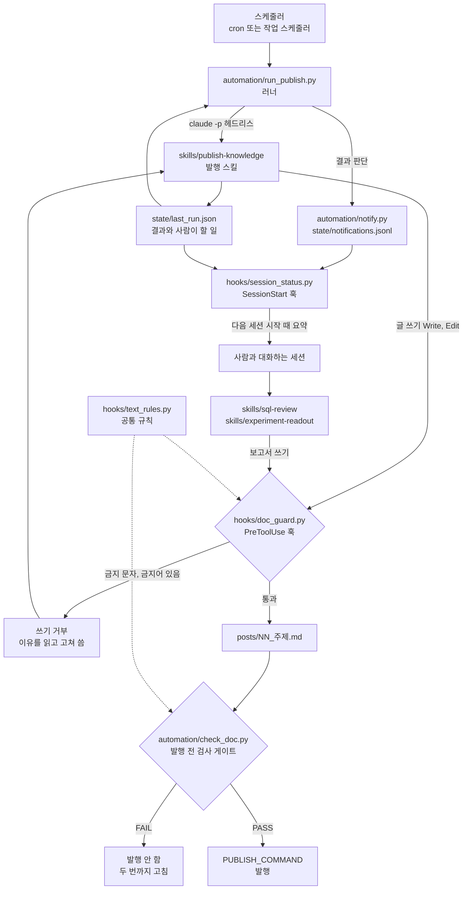

# 분석가의 Claude Code 작업 방식

분석 업무를 하다 보면 매번 같은 순서로 해야 하는 일이 많습니다. 쿼리 리뷰에서는 grain부터 보고, 실험 보고서에서는 SRM부터 보고, 공개 글에는 사내 정보가 들어가면 안 됩니다. 이 순서와 규칙을 매번 프롬프트로 설명하다 보니 빠뜨리는 날이 생겨서, 반복하는 일(SQL 리뷰, 실험 결과 보고서, 지식 글 발행)을 Claude Code 스킬로 만들고 꼭 지켜야 할 규칙은 훅과 검사 스크립트로 막아 봤습니다.

## 어떻게 나눴나

해 보면서 세 층으로 나누는 게 편했습니다.

스킬은 일의 순서와 판단 기준을 적은 문서입니다. Claude가 해당 작업을 할 때 읽습니다.

훅은 Claude Code가 특정 시점(세션 시작, 파일 쓰기 직전)에 자동으로 실행하는 스크립트입니다. 문서로 부탁하는 대신 행동을 막거나 필요한 정보를 보여 줄 수 있습니다.

마지막으로 자동 실행과 검사가 있습니다. 사람이 없는 시간에 헤드리스로 스킬을 돌리고, 검사를 통과한 결과만 공개합니다. 결과는 파일로 남겨 두고 다음 세션에서 제가 확인합니다.

여기 올린 코드와 문서는 실제로 쓰던 구성을 공개용으로 다시 쓴 것입니다. 개인 경로, 계정, 사내 용어는 모두 빼고 환경변수와 예시 값으로 바꿨습니다.

## 전체 흐름



## 폴더 구성

```
claude-code/
├── skills/
│   ├── sql-review/            # SQL 채점: 정답, grain, 효율, 실무 자연스러움
│   ├── experiment-readout/    # A/B 결과 보고서: SRM, 검정력, 다중 비교, 해석
│   └── publish-knowledge/     # 양식대로 글 쓰기, 검사 통과 시 발행
├── hooks/
│   ├── text_rules.py          # 금지 문자, 금지어 규칙 (훅과 검사가 같이 씀)
│   ├── banned_words.txt       # 금지어 예시 목록
│   ├── doc_guard.py           # PreToolUse: 문서 쓰기 직전 검사
│   ├── session_status.py      # SessionStart: 자동 작업 상태 요약
│   └── settings.example.json  # 훅 연결 예시
├── automation/
│   ├── run_publish.py         # 헤드리스 러너
│   ├── notify.py              # 로컬 알림 기록
│   ├── check_doc.py           # 발행 전 문서 검사
│   └── last_run.example.json  # 결과 파일 형식
└── tests/                     # pytest
```

## 각각 무엇을 하나

### 스킬

스킬은 세 개를 만들었습니다.

`sql-review`는 쿼리를 채점하거나 리뷰할 때 씁니다. grain을 먼저 적고, 작은 데이터로 실제로 돌려 본 다음, 수치 오류와 실행 오류를 나눠서 봅니다. 모범 답안에는 왜 그렇게 썼는지 why 주석을 답니다.

`experiment-readout`는 A/B 결과를 정리할 때 씁니다. SRM을 가장 먼저 확인하고(여기서 문제가 있으면 멈춥니다), 검정력, 1차 지표와 신뢰구간, 다중 비교 보정, 가드레일 순서로 본 뒤 출시, 중단, 재실험 중 하나로 결정합니다.

`publish-knowledge`는 정기 글 발행용입니다. 백로그 순서대로 주제를 고르고, 실제로 실행한 숫자만 써서 양식대로 글을 쓴 다음, 검사 게이트를 통과하면 발행하고 결과 파일을 남깁니다.

스킬 본문(SKILL.md)에는 순서와 멈춤 조건만 짧게 두고, 채점표, 체크리스트, 양식은 `references/`로 뺐습니다. 매번 읽는 문서가 짧아야 순서가 잘 지켜지는 것 같았습니다.

### 훅

| 훅 | 시점 | 하는 일 |
|------|------|---------|
| `doc_guard.py` | PreToolUse (Write, Edit, MultiEdit) | `.md`, `.txt`에 새로 쓰는 내용에서 금지 문자와 금지어를 찾으면 `permissionDecision: deny`로 쓰기를 거부한다. 거부 이유가 Claude에게 전달되어 고쳐 다시 쓴다 |
| `session_status.py` | SessionStart | 안 본 알림, 실패한 마지막 실행과 사람이 할 일, 오래 멈춘 스케줄을 요약한다. 문제가 없으면 아무것도 출력하지 않는다 |

### 자동 실행과 검사

`run_publish.py`는 `claude -p`로 발행 스킬을 실행하고 로그를 남깁니다. 허용 도구 목록과 별도로 `git push --force`, `rm -rf`는 거부 목록에 넣어 두었습니다. 실행이 끝나면 결과 파일을 읽어 알림을 기록합니다.

`check_doc.py`는 머리말, 필수 섹션, 링크, 금지 문자, 금지어, `[확인 필요]` 표시, 길이를 검사합니다. 하나라도 실패하면 종료 코드 1을 돌려주고, 그 글은 발행하지 않습니다.

`notify.py`는 외부 서비스로 보내지 않고 로컬 jsonl에 쌓기만 합니다. 저는 다음 Claude Code 세션의 시작 화면에서 이 알림을 확인합니다.

## 써 보며 배운 것

처음에는 스킬 문서에 "가운뎃점을 쓰지 않는다"처럼 규칙을 적어 두면 될 줄 알았습니다. 그런데 긴 세션 후반에는 다시 나왔습니다. 그래서 규칙을 발행 전 검사 스크립트로 옮겼고, 이 예시에서는 한 단계 앞인 쓰기 직전 훅에서도 막도록 했습니다. 거부 이유가 Claude에게 그대로 전달되니 알아서 고쳐 다시 씁니다. 이 폴더를 정리할 때도 같은 일이 있었습니다. 금지 문자 목록을 적은 `text_rules.py`에 그 문자 자체가 들어가 있었는데, 폴더 전체를 검사하는 테스트에서 걸렸습니다. 그 뒤로는 `chr()` 코드로만 적고 있습니다.

쓰기 훅과 발행 전 검사는 `text_rules.py` 하나를 같이 쓰게 했습니다. 규칙이 두 군데 있으면 언젠가 한쪽만 고치게 될 것 같았습니다.

자동화가 모든 판단을 하게 두지는 않았습니다. 확신이 없는 문장에는 `[확인 필요]`를 붙이게 했고, 이 표시가 남아 있으면 검사에서 발행을 막습니다. 새 주제 후보는 `proposed`로만 추가하고 제가 todo로 바꿔야 쓰게 했습니다. 실패한 실행은 `actions_needed`에 사람이 할 일을 적어 둡니다.

자동 공개 앞에는 검사 게이트를 두었습니다. 검사에 실패하면 발행하지 않고, 고치기는 두 번까지만 합니다. 무한히 고치게 두면 규칙을 우회하는 방향으로 글이 바뀌는 것으로 보였습니다. 발행에 실패하면 원고를 draft로 남기고 알림을 남깁니다.

헤드리스 실행 결과는 파일로 남겨 다음 세션에서 읽게 했습니다. 아무도 보지 않는 시간에 돈 작업은 실패해도 알 길이 없습니다. 결과 파일, 알림 기록, 세션 시작 훅을 이어 두니 다음에 Claude Code를 열 때 한 번은 보게 됩니다. 러너는 결과 파일의 시작 시각을 비교해서 지난 실행 결과를 이번 결과로 착각하지 않게 했습니다.

기존 문서는 자동으로 고치지 않기로 했습니다. Edit 훅은 새로 쓰는 부분만 검사합니다. 오래된 문서 전체를 일괄 치환하면 의도하지 않은 변경이 섞이기 쉽습니다. 이미 발행한 글의 오타도 자동으로 고치지 않고 사람이 할 일로 넘깁니다.

훅은 실패해도 작업을 멈추지 않게 만들었습니다. 입력 JSON을 못 읽으면 그냥 통과시킵니다. 막아야 할 걸 놓칠 수도 있지만 그 경우는 발행 전 검사가 한 번 더 잡습니다. 훅 오류 하나로 모든 쓰기가 멈추는 쪽이 더 나쁘다고 판단했습니다.

윈도우 인코딩은 처음부터 신경 쓰는 게 좋았습니다. stdin을 기본 인코딩으로 읽으면 한글 경로가 깨져 검사가 조용히 빗나갑니다. 그래서 바이트로 읽어 UTF-8로 풀고, 출력 JSON은 ASCII 이스케이프로 내보냅니다.

## 아쉬운 점과 다음에 해 볼 것

- `doc_guard.py`는 Write, Edit 도구만 봅니다. Bash로 파일을 만드는 경우는 쓰기 훅이 보지 못하고 발행 전 검사에서만 잡힙니다.
- 금지어 검사는 문자열 포함 여부만 봅니다. 띄어쓰기를 바꾸거나 다른 표기로 쓰면 지나가기 때문에, 사람의 마지막 확인을 대신하지는 못합니다.
- "실행한 숫자만 쓴다"는 아직 검사로 강제하지 못했습니다. 글의 숫자와 계산 스크립트 출력을 대조하는 검사를 다음에 만들어 볼 생각입니다.

## 직접 돌려 보기

```
pip install -r ../../requirements.txt
python -m pytest tests
```

훅을 연결하려면 `hooks/settings.example.json`의 내용을 프로젝트의 `.claude/settings.json`에 합치면 됩니다. 스킬은 `skills/` 아래 폴더를 프로젝트의 `.claude/skills/`로 복사합니다.

문서 검사만 따로 돌려 볼 때는 이렇게 합니다.

```
python -X utf8 automation/check_doc.py tests/fixtures/good_post.md --min-chars 200
```

정기 실행 등록 예시입니다 (경로는 자기 환경에 맞게 바꿔 주세요).

```
# cron, 격주 토요일 09:00 (짝수 주만 실행하려면 스크립트 앞에 주차 조건을 둔다)
0 9 * * 6 cd /path/to/repo/06-workflow/claude-code && python automation/run_publish.py

# 윈도우 작업 스케줄러
schtasks /Create /SC WEEKLY /MO 2 /D SAT /ST 09:00 /TN KnowledgePublish /TR "python <저장소>\06-workflow\claude-code\automation\run_publish.py"
```

환경변수는 아래처럼 씁니다.

| 이름 | 기본값 | 용도 |
|------|--------|------|
| `CLAUDE_BIN` | `claude` | 헤드리스 실행 파일 |
| `WORKFLOW_PROJECT_DIR` | 저장소 루트 | Claude Code를 실행할 폴더 |
| `WORKFLOW_STATE_DIR` | `automation/state` | 결과, 알림, 로그 |
| `WORKFLOW_MAX_DAYS` | 15 | 이 일수 넘게 실제 실행이 없으면 경고 |
| `BANNED_WORDS_FILE` | `hooks/banned_words.txt` | 금지어 목록. 실제 목록은 저장소 밖 파일로 두기를 권한다 |
| `PUBLISH_COMMAND` | 없음 | 발행 스킬이 쓰는 발행 명령 |

## 참고한 자료

- Claude Code 훅: https://docs.anthropic.com/en/docs/claude-code/hooks
- Claude Code 스킬: https://docs.anthropic.com/en/docs/claude-code/skills
- Claude Code 헤드리스 실행: https://docs.anthropic.com/en/docs/claude-code/headless
- Kohavi, Tang, Xu. Trustworthy Online Controlled Experiments (SRM, 가드레일): https://experimentguide.com/
