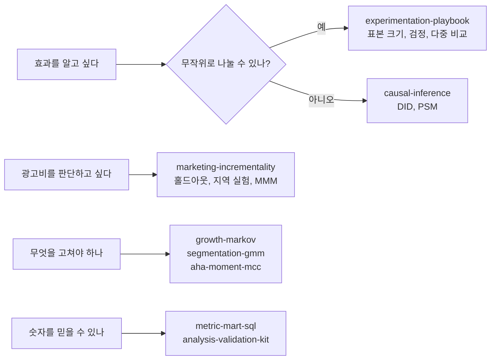

# Data Analysis

> 데이터 분석가로 일하며 고민한 질문들을 실험, 인과추론, 지표, 일하는 방식 네 갈래로 정리한 저장소다. 모든 폴더는 **질문 → 결론 → 방법 → 결과 → 한계** 순서로 쓰고, README의 숫자는 `run.py`가 다시 만들어 내며 테스트가 지킨다.

[](https://github.com/daycornday/data-analysis/actions/workflows/ci.yml)

## 한눈에 보기



## 폴더

### 1. 판단 기준: 실험을 어떻게 설계하고 읽나

| 폴더 | 답하는 질문 | 핵심 결과 |
|---|---|---|
| [experimentation-playbook](experimentation-playbook/) | 몇 명, 며칠 돌려야 하나? z와 t는 언제 다른가? | 실무 판단 기준 문서 모음. 2주마다 문서가 하나씩 늘어난다 |
| [causal-inference](causal-inference/) | 무작위 배정을 못 하면 효과를 어떻게 구하나? | 공개 데이터 재현. DID -2.25%p, PSM +$1,775 (실험 정답 +$1,794) |

### 2. 문제 발견: 무엇을 고쳐야 하나

| 폴더 | 답하는 질문 | 핵심 결과 |
|---|---|---|
| [growth-markov](growth-markov/) | 어느 전이를 1%p 고치면 활성 유저가 가장 많이 느나? | 7상태 전이행렬, 레버별 12개월 효과 순위 |
| [segmentation-gmm](segmentation-gmm/) | 합이 1인 사용 비중으로 유저를 어떻게 나누나? | 원자료 k-means ARI 0.54 → CLR + GMM 0.88 |
| [aha-moment-mcc](aha-moment-mcc/) | "N번 하면 남는다"의 N은 어떻게 고르나? | aha-ratio는 기저율에 눌린다. MCC로 고른 문턱과 비교 |

### 3. 마케팅 측정: 광고비를 무엇으로 판단하나

| 폴더 | 답하는 질문 | 핵심 결과 |
|---|---|---|
| [marketing-incrementality](marketing-incrementality/) | 기여(어트리뷰션)와 증분은 무엇이 다른가? | 마지막 클릭 기여가 증분을 3.8배 부풀림. 홀드아웃, 지역 실험, MMM 비교 |

### 4. 데이터 신뢰: 숫자를 믿을 수 있나

| 폴더 | 답하는 질문 | 핵심 결과 |
|---|---|---|
| [metric-mart-sql](metric-mart-sql/) | 원본 로그에서 지표까지 어떻게 쌓나? | staging → 스타 스키마 → 지표 레이어, 데이터 테스트 17개 |
| [analysis-validation-kit](analysis-validation-kit/) | "검증했다"는 어디까지인가? | 버그 5개를 심은 마트를 검사 11개가 잡아낸다 |

### 5. 일하는 방식

| 폴더 | 내용 |
|---|---|
| [analyst-ai-workflow](analyst-ai-workflow/) | 반복 업무를 Claude Code 스킬로, 지켜야 할 규칙은 훅과 검사로 강제한 구성 |
| [til](til/) | 짧은 학습 노트 (트래킹 유실, 예약 실행, SQL grain 체크리스트) |

## 모든 폴더가 지키는 것

- **숫자는 다시 만들 수 있다.** 폴더 안에서 `python run.py`를 실행하면 README의 숫자와 그림이 그대로 나온다
- **코드는 정답으로 검증한다.** 정답을 알고 심은 합성 데이터에서 방법이 그 정답을 되찾는지 테스트한다
- **한계를 같이 적는다.** 결과가 말해 주지 않는 것과 다음 단계를 README 끝에 둔다
- **실제 회사 데이터는 쓰지 않는다.** 공개 데이터(출처 명시) 또는 시드를 고정한 합성 데이터만 쓴다
- 자세한 규칙은 [CONVENTIONS.md](CONVENTIONS.md), 검사는 [scripts/check_repo.py](scripts/check_repo.py)와 CI가 맡는다

## 실행

```bash
pip install -r requirements.txt
python scripts/check_repo.py                 # 저장소 규칙 검사
python -m pytest growth-markov/tests -q      # 폴더별 테스트
cd growth-markov && python run.py            # 결과 재현
```

Python 3.8 이상, numpy, pandas, scipy, statsmodels, scikit-learn, matplotlib.
