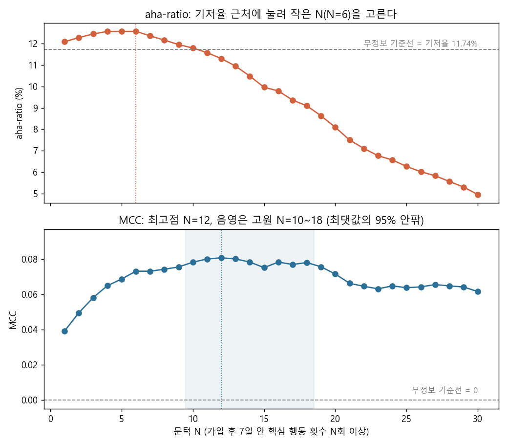

# 아하모먼트 문턱은 aha-ratio가 아니라 MCC로 고른다

> 한 줄 요약: "7일 안에 핵심 행동을 N회 이상 하면 남는다"의 N을 고를 때, 흔히 쓰는 aha-ratio는 자카드 지수라서 불균형 데이터에서 기저율 근처에 눌려 작은 N(6)을 고르고, MCC는 네 칸을 모두 써서 N = 10~18 고원(최고점 12)을 보여 준다.

## 질문

온보딩 목표를 정할 때 "가입 후 7일 안에 행동 X를 N회 하면 잔존한다"는 아하모먼트 문장을 자주 만든다. 이때 N을 어떤 지표로 고르느냐에 따라 목표가 두 배 가까이 달라진다. 잔존 유저가 소수(10% 안팎)인 데이터에서 흔히 쓰는 aha-ratio = TP / (TP + FP + FN)이 믿을 만한지, 대안은 무엇인지 확인한다.

## 결론

- 합성 유저 50,000명, 잔존 5,869명(기저율 11.74%). N을 1~30으로 훑으면 aha-ratio는 N = 6(12.58%)을, MCC는 N = 12(0.0807)를 고른다
- aha-ratio의 최댓값은 무정보 기준선(전원 "남음" 예측 = 기저율 11.74%)보다 0.84%p 높을 뿐이다. 같은 N = 1~8 구간에서 MCC는 0.0392에서 0.0742로 두 배 가까이 벌어진다
- MCC는 N = 10~18에서 0.0751~0.0807로 거의 평평하다(N = 15만 최댓값의 95% 아래). 최고점 하나보다 고원으로 읽는 편이 정확하고, 고원 양 끝은 리프트 1.43배(N = 10, 도달 19.8%)와 1.71배(N = 18, 도달 8.4%)다
- MCC 최댓값 0.0807은 R² 0.65%에 해당한다. 문턱 하나의 판별력은 약하므로 "N = 12가 아하모먼트"보다 "N = 10~18 구간 유저는 남을 확률이 평균의 1.4~1.7배"라고 말하는 편이 정직하다

## 방법

1. **합성 데이터** (`src/aha_moment_mcc/data.py`, 시드 20261020). 유저마다 숨은 관여도 z를 뽑고, z로부터 7일 안 핵심 행동 횟수와 4주차 잔존을 각각 따로 뽑는다. 행동이 잔존을 만들지 않는 구조다.

   ```python
   z = rng.normal(size=n)
   count = rng.negative_binomial(1.0, 1.0 / (1.0 + np.exp(1.6 + 0.7 * z)))
   retained = rng.random(n) < 1 / (1 + np.exp(-(-2.15 + 0.6 * z)))
   ```

2. **혼동행렬**. "count >= N이면 남을 것"으로 예측해 TP, FP, FN, TN을 센다.
3. **aha-ratio = 자카드 지수**. 행동자 집합 A(TP + FP)와 잔존자 집합 B(TP + FN)의 교집합 / 합집합이다. 포함배제로 합집합은 TP + FP + FN이고 TN만 빠진다. 전원을 "남음"으로 예측하면 값이 기저율과 같아진다.

   $$\text{aha-ratio} = \frac{TP}{TP + FP + FN}$$

4. **MCC**. 네 칸을 모두 쓴다. 0/1 예측과 0/1 실제의 피어슨 상관계수(파이 계수)와 같아서, 기저율과 관계없이 무정보 기준선이 0이다.

   $$\text{MCC} = \frac{TP \times TN - FP \times FN}{\sqrt{(TP+FP)(TP+FN)(TN+FP)(TN+FN)}}$$

5. **문턱 훑기**. N = 1~30마다 예측 양성 비율, 정밀도, 재현율, 리프트(정밀도 / 기저율), MCC, aha-ratio를 계산하고, MCC가 최댓값의 95% 이상인 N을 고원으로 본다.

## 결과



위 그림이 핵심이다. aha-ratio(위)는 기저율 점선 근처에서 거의 움직이지 않다가 N이 커지면 빠르게 떨어진다. N이 커질수록 "행동은 덜 했지만 남은 사람"(FN)이 합집합에 쌓이기 때문이고, 그래서 구조적으로 작은 N 쪽으로 쏠린다. MCC(아래)는 0에서 시작하는 기준선 위에서 문턱 사이의 차이를 드러낸다.

**무정보 예측기** (`outputs/baselines.csv`). 정확도는 아무것도 안 하는 예측기가 88.26%로 가장 높아서 쓸 수 없다. MCC만 세 예측기 모두 0 근처다.

| 예측기 | 정확도 | aha-ratio | MCC | 정밀도 | 재현율 |
|---|---|---|---|---|---|
| 전원 "안 남음" | 88.26% | 0.00% | 0 (정의상) | 정의 불가 | 0.00% |
| 전원 "남음" | 11.74% | 11.74% (= 기저율) | 0 (정의상) | 11.74% | 100.00% |
| 동전 던지기 50% | 49.89% | 10.54% | 0.0008 | 11.76% | 50.28% |

**N = 12 혼동행렬**. TN이 37,693명(전체의 75.4%)으로 가장 큰 칸인데 aha-ratio는 이 칸을 버린다.

| | 실제로 남음 | 실제로 안 남음 |
|---|---|---|
| 12회 이상 | TP 1,391 | FP 6,438 |
| 11회 이하 | FN 4,478 | TN 37,693 |

MCC 공식 값 0.080710과 `np.corrcoef(예측, 실제)` 값 0.080710의 차이는 1.25e-16(부동소수점 오차)이다. 분자를 쪼개면 잘 맞힌 정도(TP x TN / 분모) 0.1793에서 헛짚은 정도(FP x FN / 분모) 0.0986을 뺀 값이다.

**고른 문턱 비교** (`outputs/picked_thresholds.csv`, 전체 표는 `outputs/threshold_sweep.csv`)

| 기준 | N | 도달 비율 | 정밀도 | 재현율 | 리프트 | MCC | aha-ratio |
|---|---|---|---|---|---|---|---|
| aha-ratio 최고 | 6 | 34.3% | 15.0% | 43.8% | 1.28 | 0.0731 | **12.58%** |
| MCC 고원 왼쪽 끝 | 10 | 19.8% | 16.8% | 28.4% | 1.43 | 0.0782 | 11.80% |
| MCC 최고 | 12 | 15.7% | 17.8% | 23.7% | 1.51 | **0.0807** | 11.30% |
| MCC 고원 오른쪽 끝 | 18 | 8.4% | 20.1% | 14.3% | 1.71 | 0.0780 | 9.10% |

해석은 두 질문을 나눠서 한다.

- **예측 문턱**(누가 남을지 가장 잘 가르는 선): MCC 기준 N = 10~18 고원
- **개입 문턱**(유저를 어디까지 끌어올리게 할까): 고원 안에서 도달 비용과 커버리지 목표로 고른다. N = 10은 넓게(이미 19.8% 도달, 리프트 1.43배), N = 18은 좁고 정밀하게(8.4% 도달, 리프트 1.71배) 잡는 선택이다. 이 선택은 통계가 아니라 비즈니스 입력이 정한다

## 한계와 다음 단계

- **문턱은 상관이지 인과가 아니다. 실험으로 확인해야 한다.** 이 데이터에서 행동 횟수와 잔존은 둘 다 숨은 관여도에서 나왔고, 행동이 잔존을 만들지 않는다. 유저에게 억지로 12번을 시켜도 잔존은 오르지 않는다. 실제 서비스에서도 원래 관여도가 높은 유저가 행동도 많이 하고 오래 남는 경우가 흔하다. 아하모먼트는 "개입해 볼 만한 후보"를 알려 줄 뿐이고, 문턱 도달을 유도하는 개입을 A/B 테스트로 돌려 잔존 차이를 봐야 효과를 말할 수 있다
- MCC 최댓값 0.0807(R² 0.65%)은 관례상 약한 연관(절댓값 0.1 미만)이다. 방법을 제대로 밟았다는 것과 결과가 쓸 만하다는 것은 다르므로 둘을 같이 보고한다
- 고원의 폭과 최고점은 표본 변동에 흔들린다. 부트스트랩으로 N별 MCC 신뢰구간을 붙이면 "N = 12"와 "N = 18"이 통계적으로 구분되는지 확인할 수 있다
- 행동 하나, 기간 하나(7일)만 본다. 실무에서는 행동 종류와 기간(N일)도 같이 훑어야 하고, 그만큼 다중 비교로 우연히 높은 조합이 뽑힐 위험이 커진다
- 동전 던지기 예측기는 별도 난수(시드 20261021)로 뽑아서 원고(49.83%, 10.51%, -0.0002)와 소수점 값이 조금 다르다. 결론(MCC 0 근처)은 같다

## 실행

```
pip install -r ../requirements.txt
python run.py
python -m pytest tests
```

run.py는 `data/synthetic_users.csv`, `outputs/` 아래 그림 1개와 표 3개를 만든다(약 3초).

## 더 읽을 것

- Chicco, D., Jurman, G. (2020). The advantages of the Matthews correlation coefficient (MCC) over F1 score and accuracy in binary classification evaluation. *BMC Genomics*, 21, 6. https://doi.org/10.1186/s12864-019-6413-7
- Matthews, B. W. (1975). Comparison of the predicted and observed secondary structure of T4 phage lysozyme. *Biochimica et Biophysica Acta*, 405(2), 442-451.
- scikit-learn 문서, `matthews_corrcoef`: https://scikit-learn.org/stable/modules/generated/sklearn.metrics.matthews_corrcoef.html
- Wikipedia, Jaccard index: https://en.wikipedia.org/wiki/Jaccard_index
- Wikipedia, Phi coefficient: https://en.wikipedia.org/wiki/Phi_coefficient
