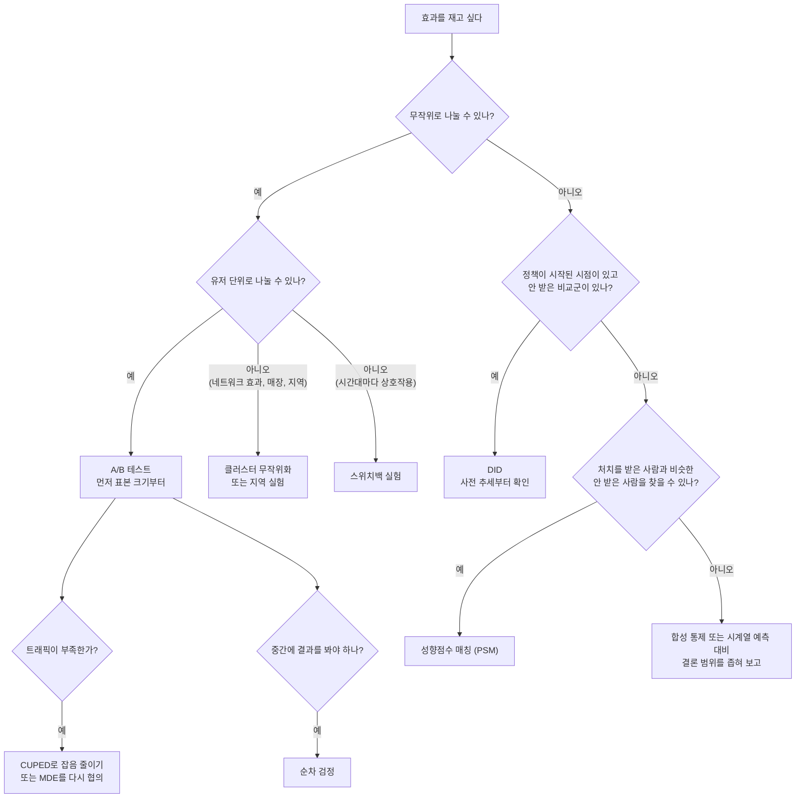

# 방법 고르기

효과를 재고 싶을 때 위에서부터 답하며 내려간다. 끝에 닿은 문서를 읽는다. "작성 예정" 문서는 [로드맵](roadmap.md)에 순서가 있다.

| 도착점 | 문서 | 상태 |
|---|---|---|
| A/B 테스트, 표본 크기 | [검정력과 표본 크기](methods/power-and-sample-size.md) | 완료 |
| CUPED | 작성 예정 | |
| 순차 검정 | 작성 예정 | |
| 다중 비교 보정 | 작성 예정 | |
| SRM 점검 | 작성 예정 | |
| 클러스터, 지역 실험 | 작성 예정 | |
| 스위치백 | 작성 예정 | |
| DID, PSM | 작성 예정 (공개 데이터 실습 포함) | |
