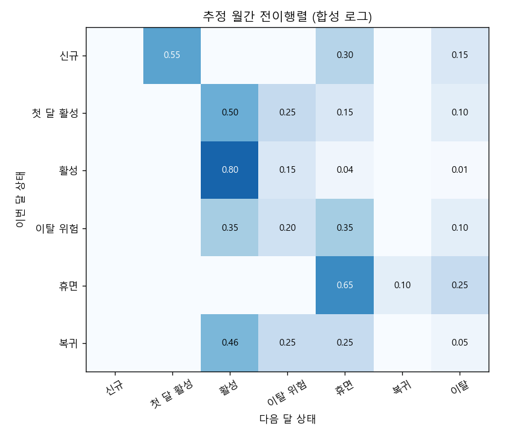
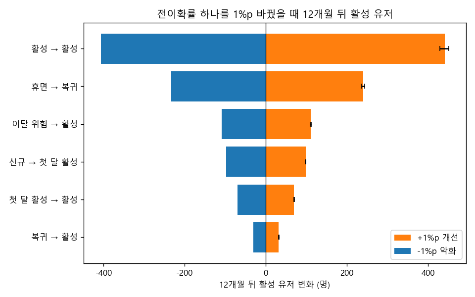
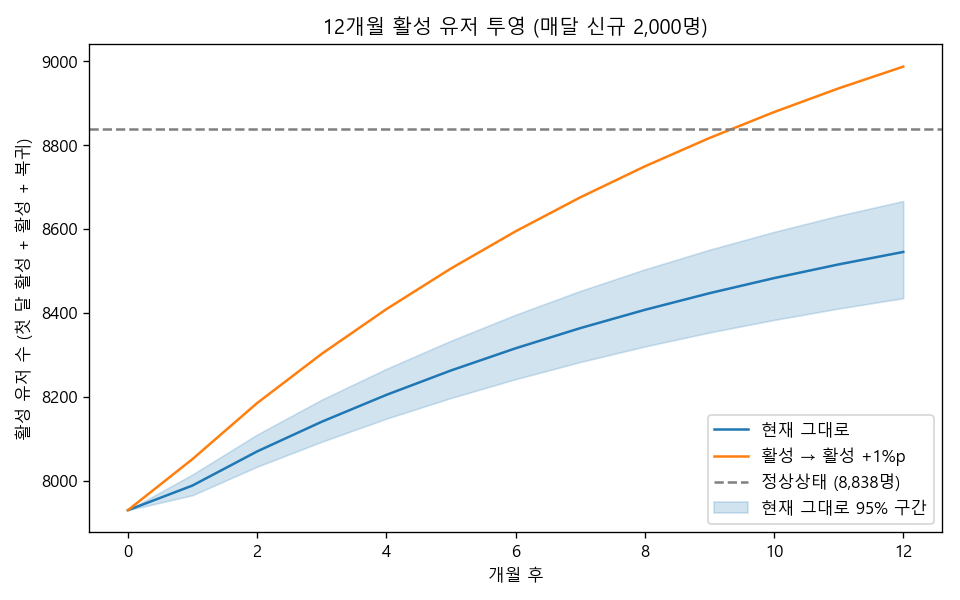

# 마르코프 체인 성장 시뮬레이터

> 한 줄 요약: 유저 상태 전이 중 어느 확률 하나를 1%p 고치면 12개월 뒤 활성 유저가 가장 많이 느는지 묻는다. 합성 데이터에서는 "활성 유지"가 1위(+442명), "휴면 → 복귀"가 2위(+240명)였고, 순위는 부트스트랩 200회 모두에서 같았다.

## 질문
리텐션 개선 과제는 늘 후보가 많다. 온보딩, 이탈 위험 알림, 휴면 유저 복귀 캠페인이 서로 같은 리소스를 두고 경쟁한다.
퍼널 단계별 전환율만 보면 "가장 낮은 단계"를 고치고 싶어지지만, 전이는 서로 이어져 있어서 한 단계를 고친 효과가 다음 달, 그다음 달로 번진다.
이 프로젝트는 월간 상태 전이를 마르코프 체인으로 놓고, 전이 하나를 같은 크기(+1%p)로 바꿨을 때 12개월 뒤 활성 유저가 얼마나 달라지는지로 레버의 크기를 비교한다.

## 결론
- 합성 로그(유저 48,000명, 유저-월 311,733행)에서 추정한 전이행렬은 정답과의 최대 오차가 0.0084였고, 유저 단위 부트스트랩 95% 구간이 정답 22칸을 모두 덮었다.
- 매달 신규 2,000명이 들어올 때 활성 유저(첫 달 활성 + 활성 + 복귀)는 현재 7,930명에서 12개월 뒤 8,545명으로 늘고, 정상상태 8,838명에 다가간다.
- 전이 하나를 +1%p 개선했을 때 12개월 뒤 활성 유저 증가: 활성 → 활성 +442명(95% 구간 429~451), 휴면 → 복귀 +240명, 이탈 위험 → 활성 +111명, 신규 → 첫 달 활성 +98명, 첫 달 활성 → 활성 +69명, 복귀 → 활성 +31명.
- 레버의 크기는 대체로 "출발 상태에 머무는 인원"이 정한다. 활성(6,300명)과 휴면(4,746명)은 사람이 많아서 1%p가 매달 큰 인원으로 바뀐다. 복귀(508명)는 전환율을 올려도 움직이는 사람이 적다.
- 이 순위는 "같은 1%p를 얻는 비용이 같다"는 가정 위의 순위다. 비용을 붙이는 일은 따로 해야 한다(한계 참고).

## 방법
1. **상태 정의 (월 단위 7개)**: 신규(가입한 달), 첫 달 활성, 활성, 이탈 위험(활동이 크게 줄어든 달), 휴면(활동 없음), 복귀(휴면 뒤 다시 활동), 이탈(정의상 되돌아오지 않는 흡수 상태). 활성 유저 수 = 첫 달 활성 + 활성 + 복귀.
2. **합성 로그**: `chain.true_transition_matrix()`의 정답 행렬로 24개월 동안 매달 2,000명이 들어오는 상태 로그를 만든다. `data/state_logs.csv.gz`.
3. **전이행렬 추정**: 같은 유저의 연속한 두 달을 (이번 달, 다음 달) 쌍으로 세고 행 합으로 나눈다.
   ```
   P_hat[i, j] = n(i → j) / sum_k n(i → k)
   ```
4. **부트스트랩 신뢰구간**: 전이 쌍이 아니라 유저를 복원추출한다. 한 유저의 전이들은 서로 독립이 아니어서 유저 단위로 묶어 뽑아야 구간이 너무 좁아지지 않는다. 200회.
5. **정상상태**: 매달 신규 a명이 들어오고 이탈은 빠져나가는 열린 시스템이다. 이탈을 뺀 부분행렬을 Q라 하면 인원 x는 다음 고정점으로 수렴한다.
   $$x = xQ + a \quad\Rightarrow\quad x = a\,(I - Q)^{-1}$$
6. **12개월 투영**: 관측 마지막 달의 상태별 인원에서 출발해 `x(t+1) = x(t) P + a`를 12번 반복한다.
7. **민감도 분석**: 레버 6개(좋은 쪽 전이)마다 확률을 +1%p 올리고, 같은 행에서 가장 나쁜 도착지(이탈, 없으면 휴면, 없으면 이탈 위험)에서 1%p를 덜어 행 합을 1로 유지한다. 12개월 뒤 활성 유저 차이를 기준선과 비교하고, -1%p 악화도 같은 방식으로 계산해 토네이도 그림으로 그린다. 부트스트랩 행렬 200개 각각에 같은 계산을 반복해 증가량의 95% 구간과 순위 안정성을 본다.

## 결과



추정 전이행렬. 활성의 80%가 다음 달에도 활성이고, 휴면의 25%는 다음 달 이탈한다. 정답과의 비교는 `outputs/transition_matrix.csv`.



| 레버 | 현재 확률 | +1%p 12개월 증가 | 95% 구간 | -1%p 12개월 변화 | +1%p 정상상태 증가 |
|---|---|---|---|---|---|
| 활성 → 활성 | 0.801 | +441.5 | 428.5 ~ 450.9 | -406.6 | +708.1 |
| 휴면 → 복귀 | 0.100 | +239.6 | 235.9 ~ 243.3 | -233.9 | +366.3 |
| 이탈 위험 → 활성 | 0.348 | +110.7 | 109.2 ~ 112.5 | -109.2 | +169.5 |
| 신규 → 첫 달 활성 | 0.550 | +97.9 | 97.0 ~ 98.7 | -97.9 | +139.4 |
| 첫 달 활성 → 활성 | 0.499 | +69.3 | 68.6 ~ 70.1 | -69.3 | +98.7 |
| 복귀 → 활성 | 0.458 | +31.5 | 30.8 ~ 32.2 | -31.4 | +47.4 |

해석:
- 1위와 2위의 차이는 구간이 겹치지 않을 만큼 크고, 부트스트랩 200회에서 1위가 바뀐 적이 없다. 추정 오차 때문에 순위가 흔들리는 상황은 아니다.
- 개선과 악화가 거의 대칭이다. 1%p 수준에서는 효과가 선형에 가깝다는 뜻이고, 같은 표를 "어느 전이가 나빠지면 가장 아픈가"로도 읽을 수 있다.
- 12개월 효과는 정상상태 효과의 60~70% 수준이다. 1년 안에 효과가 다 나타나지 않는다.
- 휴면 → 복귀의 +1%p는 0.10을 0.11로, 상대적으로 10% 올리는 일이다. 활성 → 활성의 +1%p는 활성의 직접 이탈 1%를 거의 0으로 만드는 일이다. 둘 다 같은 1%p지만 실제 난이도는 다르다.



현재 그대로 두면 12개월 뒤 8,545명, 활성 → 활성을 1%p 올리면 8,987명이다. 파란 띠는 전이행렬 추정 불확실성만 반영한 구간이다.

`outputs/steady_state.csv`: 상태별 현재 인원과 정상상태 인원.

## 한계와 다음 단계
- **마르코프 가정(기억 없음)**: 다음 달 상태가 이번 달 상태만으로 정해진다고 본다. 실제로는 휴면 3개월째와 1개월째 유저의 복귀 확률이 다르다. 휴면 기간을 상태로 쪼개거나(휴면 1개월, 2개월 이상), 2차 마르코프로 넓혀서 확인할 수 있다.
- **정상성**: 전이확률이 시간에 따라 변하지 않는다고 본다. 계절성, 제품 변경, 가입 코호트 차이가 있으면 기간을 나눠 추정하고 행렬이 같은지 먼저 검정해야 한다.
- **개선 가능성과 비용은 별개**: 이 분석은 "1%p를 얻었을 때의 가치"만 말한다. 그 1%p를 얻는 비용, 실제로 움직일 수 있는 폭은 말해 주지 않는다. 다음 단계는 레버별로 "1%p당 비용"이나 과거 실험에서 실제로 움직인 폭을 붙여 가치 대비 비용으로 다시 순위를 매기는 것이다.
- **상호작용 없음**: 한 번에 하나만 바꿨다. 두 레버를 같이 고치면 효과가 단순 합과 다를 수 있다.
- **신규 유입 고정**: 매달 신규 수를 2,000명으로 고정했다. 활성 유저가 늘면 추천으로 신규가 느는 효과는 넣지 않았다.
- **합성 데이터**: 숫자는 방법을 보여 주기 위한 것이다. 실제 서비스에 쓰려면 상태 정의(무엇을 활동으로 볼지)부터 합의해야 한다.

## 실행
```
pip install -r ../requirements.txt
python run.py
python -m pytest tests
```
run.py는 시드 42로 고정되어 있어 위 숫자가 그대로 나온다. 실행 시간은 10초 안쪽이다.

## 더 읽을 것
- J. R. Norris, *Markov Chains*, Cambridge University Press, 1997. 흡수 상태와 정상분포의 기초.
- J. G. Kemeny, J. L. Snell, *Finite Markov Chains*, Springer, 1976. 흡수 체인의 기본 행렬 (I - Q)^-1.
- P. E. Pfeifer, R. L. Carraway, "Modeling customer relationships as Markov chains", *Journal of Interactive Marketing*, 2000. 고객 생애가치를 마르코프 체인으로 계산하는 방법.
- B. Efron, R. J. Tibshirani, *An Introduction to the Bootstrap*, Chapman and Hall, 1993. 묶음(유저 단위) 재표본의 근거.
